# archpilot

**Plan before you code.** An MCP server and Claude Code skill that interviews you about your
idea, runs a pre-mortem, and writes a validated architecture diagram plus an
`ARCHITECTURE.md` your coding agent follows as a contract.

<!-- TODO: demo GIF (60 seconds: idea -> interview -> diagram -> ARCHITECTURE.md) -->
<!--  -->

Coding agents start building the moment you describe an idea. archpilot makes them stop and
ask the questions you forgot first (scale, budget, data sensitivity, the one thing that must
not fail), weigh trade-offs out loud, and name the top five ways the design will fail. Then
it turns the plan into a contract the agent must flag deviations from.

> **Status: v0.1, early.** Greenfield planning only. Not yet published to npm: until the
> first release, [install from source](#from-source).

## 60-second quickstart

Needs Node.js 22.13+ and Claude Code.

```bash
# 1. Chromium for diagram rendering (one time)
npx puppeteer browsers install chrome-headless-shell

# 2. The MCP server (all projects)
claude mcp add --scope user archpilot -- npx -y archpilot-mcp

# 3. The planning skill (all projects)
npx -y archpilot-mcp install-skill
```

Restart Claude Code, open an empty project folder and say:

> Plan the architecture for a booking app for physiotherapy clinics before we write code.

You get a short interview, a draft with trade-offs and a pre-mortem, then
`docs/architecture/diagram.svg` and `ARCHITECTURE.md` in your project.

## Example output

Generated unedited by the eval run for a help-center support assistant
([full ARCHITECTURE.md](examples/support-rag-bot/ARCHITECTURE.md)):



Each `ARCHITECTURE.md` contains: summary, diagram (image + Mermaid source), components,
data flow, key decisions with rejected alternatives, risks and pre-mortem with mitigations,
open questions, and **rules for the coding agent** ("follow this architecture; flag any
deviation instead of silently changing it"). More in [examples/](examples/).

## How it works

Two parts:

- **The skill** ([skills/archpilot/SKILL.md](skills/archpilot/SKILL.md)) is the brain. It
  triggers when you ask to plan or architect a project and then:
  1. Interviews you in short rounds (at most 3 to 4 questions, each with a default).
  2. Picks the closest reference architecture and explains deviations.
  3. Drafts components, data flow and decisions, checked against a list of commonly
     forgotten concerns (auth, rate limits, idempotency, backups, cost per request, data
     deletion...).
  4. Runs a pre-mortem: top 5 ways the design fails, each with a mitigation.
  5. Validates the Mermaid diagram and repairs it from structured errors (up to 3 times,
     then simplifies).
  6. Renders the diagram and exports `ARCHITECTURE.md`.
  7. Ends with a summary and the exact first build step.
- **The MCP server** is the hands: deterministic tools for validating, rendering, exporting
  and pattern lookup.

### MCP tools

| Tool                     | What it does                                                                                                                 |
| ------------------------ | ---------------------------------------------------------------------------------------------------------------------------- |
| `validate_diagram`       | Validates Mermaid source. Returns `ok`, or `{ code, message, line, hint }`.                                                  |
| `render_diagram`         | Validates and renders to `svg`/`png` inside the project; returns the path.                                                   |
| `export_architecture_md` | Writes `ARCHITECTURE.md`: components, data flow, decisions, pre-mortem, diagram, open questions, rules for the coding agent. |
| `list_patterns`          | Lists reference architectures; with `query`, ranked by relevance.                                                            |
| `get_pattern`            | Full pattern: components, trade-offs, failure modes, cost drivers, diagram.                                                  |

Errors are always structured JSON: `{ ok: false, error: { code, message, line?, hint? } }`.
Diagram error codes: `EMPTY_SOURCE`, `SOURCE_TOO_LARGE`, `UNKNOWN_DIAGRAM_TYPE`,
`UNBALANCED_BRACKET`, `RESERVED_WORD`, `BAD_ARROW`, `UNQUOTED_SPECIAL_CHAR`, `PARSE_ERROR`,
`RENDER_TIMEOUT`, `OUTPUT_TOO_LARGE`, `RENDERER_UNAVAILABLE`, `RENDER_FAILED`. Path errors:
`INVALID_OUTPUT_PATH`, `PATH_OUTSIDE_PROJECT`. Anything unexpected: `INTERNAL_ERROR`.

### Pattern library

Eight opinionated reference architectures in [patterns/](patterns/): RAG app, multi-tenant
SaaS, event-driven pipeline, agent system with tools, mobile app + API backend, data/ML
pipeline, realtime collaboration app, internal admin tool. Each has trade-offs, at least
three failure modes with mitigations, what not to use it for, and a render-tested diagram.

## Install

### npm

```bash
claude mcp add --scope user archpilot -- npx -y archpilot-mcp   # MCP server
npx -y archpilot-mcp install-skill                              # skill, all projects
npx -y archpilot-mcp install-skill --project                    # or: this project only
```

Other MCP clients: run `npx -y archpilot-mcp` as a stdio server. It writes files inside the
directory it is started in (override with `ARCHPILOT_PROJECT_ROOT`).

### From source

```bash
git clone https://github.com/saimsheikh/archpilot.git
cd archpilot
npm install
npx puppeteer browsers install chrome-headless-shell
npm run build
claude mcp add --scope user archpilot -- node "$PWD/dist/index.js"
node dist/index.js install-skill
```

### Headless Chromium

mermaid-cli renders through Puppeteer. Recent npm versions skip install scripts, so the
browser may not download automatically; `npx puppeteer browsers install chrome-headless-shell`
fixes that. If it is missing, tools return `RENDERER_UNAVAILABLE` with that command as the
hint.

On Linux containers or CI running as root, Chromium needs its sandbox disabled:

```bash
echo '{ "args": ["--no-sandbox", "--disable-setuid-sandbox"] }' > puppeteer.json
export ARCHPILOT_PUPPETEER_CONFIG="$PWD/puppeteer.json"
```

### Configuration

| Variable                           | Default           | Meaning                                |
| ---------------------------------- | ----------------- | -------------------------------------- |
| `ARCHPILOT_PROJECT_ROOT`           | working directory | Directory all output must stay inside  |
| `ARCHPILOT_RENDER_TIMEOUT_MS`      | `60000`           | Per-render timeout                     |
| `ARCHPILOT_MAX_SOURCE_BYTES`       | `50000`           | Max diagram source size                |
| `ARCHPILOT_MAX_OUTPUT_BYTES`       | `10485760`        | Max rendered file size                 |
| `ARCHPILOT_MAX_CONCURRENT_RENDERS` | `2`               | Parallel browser renders               |
| `ARCHPILOT_PUPPETEER_CONFIG`       | unset             | Puppeteer launch config file           |
| `ARCHPILOT_RETRIEVER`              | `keyword`         | Pattern retriever: `keyword` or `bm25` |

### Safety

- mermaid-cli runs with an argument array, never a shell; diagram source goes to a private
  temp dir that is always deleted.
- Mermaid runs with `securityLevel: "strict"`.
- Output paths must stay inside the project: `..`, absolute paths elsewhere and symlink
  escapes are rejected.
- Errors never contain stack traces or local paths; details go to stderr.
- Renders have a timeout, size limits and a concurrency cap.

## Evals

`npm run eval` runs 10 project ideas ([evals/ideas.json](evals/ideas.json)) through two
conditions using Claude via the Claude Code CLI (headless, with no settings, plugins, tools
or MCP):

- **baseline**: one plain prompt, "Draw me an architecture diagram for this project. Use
  Mermaid", rendered once with no repair.
- **archpilot**: the skill's flow run non-interactively: pattern retrieval, the
  forgotten-concerns checklist, a pre-mortem, structured output, validation with up to 3
  repairs then simplify, then render and export `ARCHITECTURE.md`.

Latest run (Claude Sonnet, 10 ideas, one run each; full table in
[evals/results/results.md](evals/results/results.md)):

| Metric                                                                               | archpilot | baseline |
| ------------------------------------------------------------------------------------ | --------- | -------- |
| First-pass render success                                                            | 100%      | 100%     |
| Render success after repair loop                                                     | 100%      | 100%     |
| Avg repair attempts                                                                  | 0         | 0        |
| Avg rubric score (auth, data store, failure handling, observability, cost, security) | 5.9 / 6   | 3.5 / 6  |
| Mentions cost                                                                        | 90%       | 10%      |
| Mentions failure handling                                                            | 100%      | 50%      |

What this does and does not show:

- Sonnet produced valid Mermaid on the first try in every case, in both conditions. The
  repair loop was never exercised in this run, so these numbers say nothing about its
  value; it is covered by unit tests only.
- The rubric is keyword evidence that a concern is mentioned, not a judgment of design
  quality. The archpilot prompt includes a checklist naming these concerns, so part of the
  gap is the method asking for them.
- 10 ideas, one run each: expect run-to-run variance.

Every prompt and output is recorded under `evals/runs/<run>/recordings`, so a run can be
re-scored without calling the model: `npm run eval -- --replay evals/runs/<run>/recordings`.
Options: `--model`, `--only <idea-id>`, `--limit <n>`, `--concurrency <n>`. Pattern
retrieval has its own eval: `npm run eval:retrieval` ([results](evals/retrieval/results.md)).

## Limitations

- **Greenfield only.** It plans new projects; it does not read an existing codebase.
- **Pattern retrieval is keyword-based and always returns a best match.** On its own 20
  labeled queries it scores 90% top-1, but those were written alongside the patterns. On the
  10 eval ideas, 4 got a poor-fit pattern (for example, the tutor marketplace got the RAG
  pattern because there is no marketplace pattern). In 3 of those 4 plans the model
  explicitly rejected or narrowed the pattern; the fourth did not mention it. A relevance
  threshold is needed.
- **Mermaid only.** D2 and Excalidraw are possible behind the renderer interface but not
  built.
- **Slow renders.** Every validation or render launches headless Chromium: about 2 to 4
  seconds each.
- **Heavy install.** mermaid-cli pulls in Puppeteer and a Chromium download.
- **Plan quality depends on the model.** The skill structures the conversation; it cannot
  make a weak model reason well.
- **Windows:** a render that hits the timeout may leave a Chromium process running.

## Roadmap

- Relevance threshold for pattern retrieval, then an embeddings retriever (the
  `PatternRetriever` interface is ready for it).
- More patterns: marketplace, healthcare/regulated data, IoT telemetry.
- A persistent browser for much faster validation.
- Claude Code plugin packaging (skill + server in one install).
- v2, once v1 has real users: existing-repo mode (tree-sitter structure extraction) and drift
  detection between `ARCHITECTURE.md` and the code, usable in CI.

## Development

```bash
npm run build          # compile to dist/
npm run dev            # run the server from source over stdio
npm run lint           # eslint + prettier check
npm run typecheck
npm test               # unit + renderer tests (launch Chromium)
npm run test:e2e       # builds, then drives the server over stdio
npm run verify:pack    # packs, installs the tarball in a temp project, drives the installed server
npm run eval           # full eval (uses your Claude Code quota)
```

See [CONTRIBUTING.md](CONTRIBUTING.md).

## License

MIT
