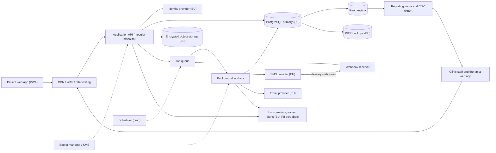

# Physio Clinic Network Appointment Booking: Architecture

Online booking for a network of 15 physiotherapy clinics. Patients choose a therapist and time slot, receive SMS reminders and fill in intake forms containing health information. Clinic staff and therapists manage schedules, availability and patient records. All patient data is stored and processed in the EU. The design is a small modular monolith on managed EU services with a background worker for SMS and email. Analytics is limited to reporting views on a read replica.

## Diagram

## Components

| Component | Responsibility | Technology |
| --- | --- | --- |
| Patient web app | Mobile-first booking flow: browse clinics and therapists, pick a slot, manage or cancel bookings, fill in intake forms. | React/Next.js PWA served via CDN |
| Staff web app | Schedule management, therapist availability, blocking time, viewing intake forms, simple reports. | Same front-end codebase, role-gated routes |
| Edge (CDN/WAF) | TLS termination, WAF, per-IP and per-route rate limiting, bot protection on booking and login endpoints, request size limits. | Managed CDN/WAF with EU processing |
| Application API | Booking logic, availability calculation, authorization (clinic-scoped RBAC enforced in one policy layer plus Postgres row-level security), intake form handling, audit logging, input and pagination limits. | TypeScript (Node) modular monolith on a managed container platform in an EU region, 2+ instances |
| Identity provider | Staff login with email + MFA (or the organisation's SSO). Patient login by email magic link or SMS one-time code. Issues short-lived JWTs. | Managed EU-hosted IdP (e.g. Keycloak hosted in the EU, or an EU-region tenant of a commercial IdP) |
| PostgreSQL primary | System of record: clinics, therapists, slots, appointments, patients, intake answers, audit log, job outbox. A slot exclusion constraint prevents double booking. Intake answers are encrypted at the application level with per-field keys. | Managed PostgreSQL, EU region, multi-AZ, encryption at rest, PITR |
| Read replica and reporting | Occupancy, no-show and utilization reports for clinic managers without loading the primary. Contains no free-text health data. | Postgres replica + SQL views, CSV export |
| Object storage | Optional uploaded documents (referral letters, scans) with a size cap, malware scan and versioning. | EU S3-compatible bucket, SSE-KMS, private, signed URLs |
| Job queue and workers | Sends SMS and email confirmations and reminders, processes webhooks, runs retention and deletion jobs. Idempotent handlers, bounded retries with backoff, visible dead-letter queue. | Postgres-backed queue (e.g. pg-boss/Graphile Worker) fed by a transactional outbox; separate worker process |
| Scheduler | Enqueues reminder jobs (e.g. 24h and 2h before an appointment), retention sweeps and a reconciliation job. | Cron on the platform or in-queue schedules |
| SMS and email providers | Deliver reminders and confirmations. SMS bodies carry no health information, only clinic, time and a link. | EU-based SMS provider with an EU DPA and a sender ID; EU email provider |
| Webhook receiver | Verifies signatures on delivery receipts and inbound replies (e.g. reply C to cancel), stores raw events with a processed-event id, and enqueues processing. | Endpoint in the API service |
| Observability | Structured JSON logs with request ids, latency/error/saturation metrics, traces, alerts on SLO breaches, dead-letter depth and SMS failure rate. Patient identifiers are masked before leaving the app. | EU-hosted logging/metrics stack (e.g. Grafana/Loki or an EU region of a managed vendor) |
| Secret manager and KMS | Holds API keys, DB credentials and field-encryption keys. Keys are rotated. Services use workload identity. No secrets in the repo. | Cloud secret manager and KMS in the EU region |
| Backups | Automated daily backups with point-in-time recovery, restored quarterly to prove they work. Backups stay in the EU and are encrypted. | Managed DB backups plus cross-AZ copy |

## Data flow

1. **Patient web app → Application API**: Patient searches availability and books a slot. The API creates the appointment in one transaction, with a unique/exclusion constraint on therapist and time and an idempotency key.
2. **Application API → PostgreSQL primary**: Appointment, audit entry and outbox row are written in the same transaction, so a partial write cannot lose a notification.
3. **PostgreSQL primary → Job queue and workers**: The outbox is relayed to the queue, which triggers a confirmation SMS or email. Reminder jobs are scheduled relative to the appointment time.
4. **Job queue and workers → SMS and email providers**: Send a message with timeouts, bounded retries and an idempotency key. The worker re-checks that the appointment is still active before sending.
5. **SMS and email providers → Webhook receiver**: Signed delivery receipts and replies are verified, stored and processed asynchronously.
6. **Patient web app → Application API**: Intake form submitted over TLS. Sensitive fields are encrypted at the application level before storage, and the payload size is capped.
7. **Staff web app → Application API**: Staff manage schedules. Every request is authorized against the user's clinic scope, and reads of patient health data are written to the audit log.
8. **PostgreSQL primary → Read replica and reporting**: Streaming replication feeds aggregate reports that exclude free-text health data.
9. **Application API → Identity provider**: Tokens are validated. Patients and staff authenticate with the IdP, and workers use workload identity or scoped service credentials.
10. **Application API → Observability**: PII-scrubbed structured logs, metrics and traces carrying a request id.

## Key decisions

### Use a transactional modular monolith instead of the data/ML pipeline reference

- **Why:** The product is an OLTP booking app. It has no ML, no multi-source ingestion and no warehouse need. At about 1.5k appointments/day one Postgres instance is ample. From the reference we keep only the useful ideas: quality/freshness checks (a reconciliation job), alerts on failure, and a separate read path for reporting.
- **Trade-offs:** Reporting is limited to what SQL on a replica can do. If clinics later want cross-network analytics or forecasting, add an ELT pipeline into a warehouse and extract only pseudonymized data.
- **Rejected:** Warehouse + dbt + BI stack (over-engineered for 15 clinics); Microservices (operational cost with no scaling need); Feature store / model serving (no ML requirement)

### Host everything in a single EU region with EU-based processors and a signed DPA with each

- **Why:** Patient health data is special-category data under GDPR. Keeping the database, backups, logs, SMS provider and email provider in the EU avoids third-country transfers.
- **Trade-offs:** Fewer vendor choices and some cost premium. The cloud provider may be subject to non-EU law, so field-level encryption with EU-held keys reduces that exposure.
- **Rejected:** US hyperscaler default regions; Self-hosting on bare metal (higher operational burden for the team size)

### Prevent double booking with a database exclusion constraint and idempotent booking requests

- **Why:** Concurrent bookings are the central correctness risk. The database is the one place that can enforce slot uniqueness reliably.
- **Trade-offs:** The UI must handle a 'slot just taken' response gracefully. Short-lived slot holds, if added, need expiry handling.
- **Rejected:** Application-level locks or Redis locks; Check-then-insert without a constraint

### Authorization in one policy layer (clinic-scoped RBAC) backed by Postgres row-level security; roles: patient, therapist, clinic staff, clinic manager, network admin

- **Why:** Staff should see only their own clinic's data. Two enforcement layers make a missed check in one endpoint non-fatal.
- **Trade-offs:** RLS adds some complexity to migrations and tests. Cross-clinic therapists need explicit multi-clinic grants.
- **Rejected:** Per-endpoint ad hoc checks; Separate database per clinic (15x operational overhead)

### Buy authentication from a managed EU-hosted IdP: MFA for staff, passwordless (magic link or SMS OTP) for patients

- **Why:** Avoids storing passwords and gives lockout and credential-stuffing protection. Passwordless suits occasional patient use.
- **Trade-offs:** Vendor dependency and a per-MAU bill. SMS OTP costs money and is open to SMS pumping, so it is rate limited, with email as the default.
- **Rejected:** Home-grown password auth; Social login (sends health-app usage to non-EU identity providers)

### Postgres-backed job queue fed by a transactional outbox rather than a separate broker

- **Why:** Volume is small (thousands of messages/day), the outbox gives atomic writes with notifications, and there is one fewer system to run.
- **Trade-offs:** Queue load shares the primary database. Move to a dedicated broker if job throughput grows significantly.
- **Rejected:** Kafka / RabbitMQ / managed streaming (unneeded complexity); Sending SMS inline in the request (slow and not retry-safe)

### SMS reminders contain no health information; they carry only clinic name, time and a short link

- **Why:** SMS is unencrypted and visible on lock screens. Minimizing content limits the harm of a leak or misdelivery.
- **Trade-offs:** Less informative messages. Patients must open the link to see details after re-authenticating.
- **Rejected:** Including therapist or treatment type in the message body

### Encrypt intake answers at the application level (field-level, envelope keys in KMS) on top of disk encryption

- **Why:** Limits exposure from DB credential leaks, replicas and backups, and enables crypto-shredding on patient deletion.
- **Trade-offs:** Encrypted fields cannot be queried or reported on directly. Key management must be tested.
- **Rejected:** Disk-level encryption only

### Handle deletion, export and retention explicitly

- **Why:** GDPR requires erasure and access requests to be honored. A deletion job removes or crypto-shreds patient data and associated files. Backups age out within 35 days, which is documented in the privacy notice. Medical record retention follows national law, so deletion of clinical records may be legally limited.
- **Trade-offs:** Patient erasure may be partial where clinics have a legal duty to retain treatment records. Logs retain no PII, with 30-day retention.
- **Rejected:** Manual deletion on request; Indefinite retention

### Abuse controls: per-IP and per-account rate limits on login, OTP and booking, bot challenge on public booking, per-patient caps on open bookings and SMS sends, max payload size, paginated lists

- **Why:** A public booking form is open to slot hoarding, SMS pumping and scraping of therapist availability.
- **Trade-offs:** Some friction for genuine users. Limits need tuning.
- **Rejected:** No limits until abuse is observed

### Operations baseline: local, staging and production environments; zero-downtime rolling deploys with automatic rollback; expand/contract migrations; dependency scanning and automated updates; error and uptime alerts to an on-call rota

- **Why:** A small team needs predictable releases. Booking must stay up during working hours.
- **Trade-offs:** Extra CI setup and a staging bill. Staging uses synthetic data only, never production patient data.
- **Rejected:** Production-only environment; Using a copy of production data for testing

### Degraded mode when third parties fail: booking continues if SMS or email is down, with messages queued and retried. If the IdP is down, existing sessions continue until token expiry.

- **Why:** Reminders matter, but bookings are the core job. The outbox ensures nothing is lost.
- **Trade-offs:** Late reminders are possible during an outage. A secondary SMS provider is not built but the sender interface is abstracted to allow one.
- **Rejected:** Blocking bookings until a confirmation SMS is sent

## Risks and pre-mortem

| Risk | Category | Likelihood | Mitigation |
| --- | --- | --- | --- |
| Cross-clinic or cross-patient data exposure: a missed authorization check or an IDOR bug lets a user from one clinic, or a patient, read another person's health data. | security | medium | Enforce clinic scoping with Postgres RLS in addition to the policy layer, add automated cross-tenant access tests in CI, audit-log every health-data read, and commission a penetration test before launch. |
| SMS cost blowout from SMS pumping or OTP abuse, or from a reminder bug that sends duplicates, creating a large unexpected bill. | cost | medium | Use email as the default OTP channel, cap SMS per number and per day, restrict destination country codes to expected ones, make send handlers idempotent, and set provider spend limits with alerts at 50% and 80% of budget. |
| SMS or IdP vendor outage or price hike during working hours means missed reminders (higher no-show rate) or staff locked out. | vendor | medium | Wrap providers behind a sender interface, queue and retry with a dead-letter alert, keep email as a fallback reminder channel, and document a tested procedure to switch SMS provider within a day. Revisit a secondary provider if no-show rate rises during an outage. |
| Stale or duplicate reminders: reminder jobs fire for appointments that were rescheduled or cancelled, or are lost, because job state diverges from appointment state. | data | high | Workers re-read appointment state before sending, jobs carry an appointment version, a nightly reconciliation job compares upcoming appointments against scheduled reminders and alerts on mismatches. |
| Monday-morning and post-reminder traffic spikes (patients opening links, rebooking at once) plus double-booking races overload the single primary database or produce slot conflicts. | scaling | low | Keep availability reads cached for a few seconds and served from the replica, rely on the exclusion constraint for correctness, load test at 10x expected peak before launch, and move to a larger instance or dedicated queue broker if CPU stays above 60%. |

## Open questions

- Assumption: roughly 15 clinics, 100-150 therapists and up to ~1,500 appointments/day, about 50k patients in total. Revisit if the real numbers are 10x higher.
- Assumption: patients can be new (guest booking with email/phone verification) or returning (account created on first booking).
- Assumption: no online payments in v1, so no PCI scope. Is payment or insurance billing required?
- Assumption: the clinics already operate under a single legal entity acting as data controller, with this platform and its vendors as processors. Is that correct?
- Assumption: clinics are in one or two EU countries; language is localized per country and retention follows national medical-record law. Which countries are in scope?
- Assumption: the system is the scheduling system of record and holds intake data, not full clinical notes (no EHR). Is integration with an existing EHR or practice management system required?
- Assumption: no calendar sync (Google/Outlook) in v1. Do therapists need it?
- Assumption: SMS reminders at 24h and 2h before an appointment, with reply-to-cancel optional. Confirm desired timing and consent wording.
- Assumption: a DPIA and DPO review will be completed before launch; this document does not replace legal review.
- Assumption: a team of 2-4 engineers, managed cloud services, and an on-call rota during clinic hours.
- Assumption: availability target of 99.5% monthly, with RPO of 5 minutes and RTO of 4 hours.
- Which identity provider and cloud region are preferred, and is there an existing contract with an EU-based SMS vendor?

## Rules for the coding agent

- Follow this architecture. Components, boundaries and data flow above are the contract.
- If a change requires deviating from it, stop and flag the deviation with the reason instead of silently changing the design.
- Do not add components, services or dependencies that are not listed here without flagging them first.
- Address the mitigations in the pre-mortem as you build the affected components.
- Resolve open questions with the user before building the parts they affect.
