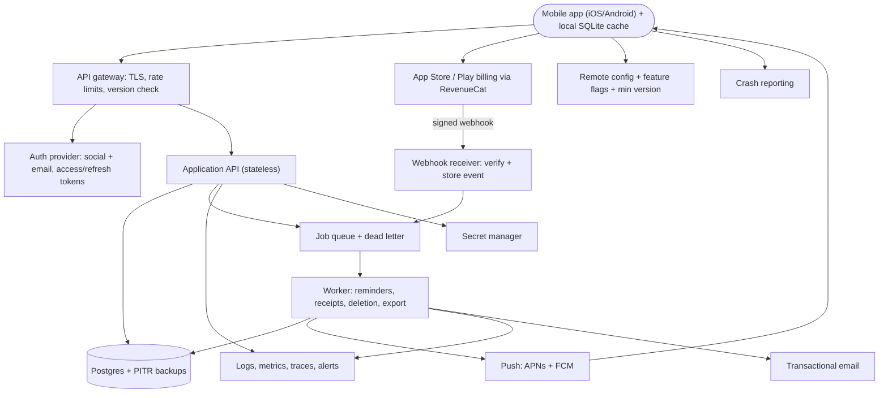

# Habit Tracker (iOS + Android): Architecture

A cross-platform mobile habit tracker for individuals who want to build habits with daily check-ins, streaks and push reminders. The app works fully offline using a local database. Signed-in users can optionally sync across devices. A premium subscription (bought through the App Store or Google Play) unlocks extra features. Sized for about 200k monthly active users, which is a modest load that fits a single Postgres instance and a small stateless API.

## Diagram

## Components

| Component | Responsibility | Technology |
| --- | --- | --- |
| Mobile app | Local-first habit logging and streak calculation against a local SQLite database. Queues sync writes with idempotency keys, schedules local fallback reminders, handles the force-update screen, and shows paywall and entitlements. | React Native or Flutter (single codebase), SQLite |
| API gateway / BFF | TLS termination, per-IP and per-user rate limits, payload size limits, API version routing, minimum-supported-version check, request id injection. | Managed gateway or reverse proxy on the app platform (e.g. Cloudflare in front of the API) |
| Auth provider | Sign in with Apple, Google and email magic link; issues short-lived access tokens and rotating refresh tokens. Bought rather than built. Anonymous use stays local-only until sign-in. | Managed auth (Supabase Auth, Clerk or Firebase Auth) |
| Application API | Stateless REST API (versioned, additive-only changes) for habits, check-ins, sync push/pull, device push-token registration, entitlement lookup, account deletion and export requests. Authorization enforced in one middleware: every query is scoped by user_id. | Node.js (TypeScript) or Go container, 2+ instances |
| Postgres | Source of truth for users, habits, check-ins (append-only events with client-generated ids), device tokens, entitlements, processed webhook events. Automated daily backups with point-in-time recovery. | Managed Postgres, one primary, add read replica later |
| Job queue and workers | Run slow or third-party work: scheduled reminder fan-out, push sending, receipt/entitlement reconciliation, account deletion, data export, transactional email. Bounded retries with backoff and a visible dead-letter queue. | Postgres-backed queue (pg-boss/graphile-worker) to avoid extra infrastructure; move to SQS/Redis if needed |
| Push service | Delivers reminders via APNs and FCM. Tokens refreshed on app start, pruned on provider errors, delivery rate tracked. Reminders are per-user timezone-aware and sent in jittered batches. | APNs, FCM (via FCM for both platforms or direct APNs) |
| Subscription billing (RevenueCat) | Wraps App Store and Google Play billing, receipt validation and entitlement state, so the team does not write receipt validation. The app reads entitlement from RevenueCat SDK; the backend mirrors it via webhooks. | RevenueCat |
| Webhook receiver | Verifies RevenueCat signature/auth header, stores the raw event with its event id (dedupe), returns 200 fast, and enqueues processing. | Endpoint in the Application API |
| Remote config and feature flags | Minimum supported version, force-update, kill switches for sync and premium features, gradual rollouts. | Firebase Remote Config or PostHog flags |
| Crash reporting and analytics | Crash and ANR reporting; privacy-minimal product analytics with no habit names (they can be sensitive). | Sentry or Firebase Crashlytics |
| Observability stack | Structured JSON logs with request id and PII masking, latency/error/saturation metrics, queue depth and push delivery metrics, alerts routed to on-call. | Managed (Grafana Cloud, Datadog or platform-native) with uptime checks |
| Secret manager | Holds APNs keys, FCM credentials, DB credentials, webhook secrets; injected as env vars at deploy, with a rotation runbook. | Platform secret store (AWS Secrets Manager, Doppler, or similar) |
| Transactional email | Magic-link/auth emails (if not covered by the auth provider), data export ready, and account deletion confirmation. | Postmark or SES |

## Data flow

1. **Mobile app → Auth provider**: User signs in (Apple, Google or email); app stores refresh token in the OS keychain/keystore.
2. **Mobile app → API gateway / BFF**: Sync push of queued check-ins and habit edits, each with an idempotency key; pull of changes since a cursor. Exponential backoff with jitter on failure.
3. **API gateway / BFF → Application API**: Forwards requests after rate limiting, size limits and version check, with a request id.
4. **Application API → Postgres**: Idempotent upserts of check-ins and habits keyed by client ids; last-write-wins per habit field, check-ins merged as a set.
5. **Application API → Job queue and workers**: Enqueues deletion, export and reconciliation jobs.
6. **Job queue and workers → Push service**: Per-minute scheduler selects users whose reminder is due in their timezone and sends push in batches; skips users who already checked in.
7. **Push service → Mobile app**: Reminder notification delivered; invalid-token errors flow back to prune device tokens.
8. **Mobile app → Subscription billing (RevenueCat)**: Purchase through the store; entitlement read from the RevenueCat SDK, so premium works even if our backend is down.
9. **Subscription billing (RevenueCat) → Webhook receiver**: Signed lifecycle events (renewal, cancel, billing issue) delivered to us.
10. **Webhook receiver → Job queue and workers**: Stored event id is deduped; a job updates the entitlement row so server-gated features (sync) follow subscription state.
11. **Mobile app → Remote config and feature flags**: On start, fetches min version and flags; shows force-update if below minimum, with cached last-known values on failure.
12. **Mobile app → Crash reporting and analytics**: Crash reports and minimal events, without habit names or personal data.
13. **Application API → Observability stack**: Logs, metrics and traces; workers also report queue depth, retries and dead letters.
14. **Job queue and workers → Transactional email**: Sends export-ready and deletion confirmations; retried idempotently.

## Key decisions

### Offline-first with local SQLite; sync is optional and queue-based.

- **Why:** Habit logging must work with no signal, and sync is opt-in anyway. Check-ins are naturally append-only events with client-generated ids, which makes merging simple and conflict-free.
- **Trade-offs:** More client complexity than a pure online app, plus a sync cursor and tombstones for deletes. Kept small by limiting conflicts to last-write-wins on habit fields.
- **Rejected:** Online-only with read cache: logging fails on subway or flights, which hurts the core loop; CRDT library: overkill for this data shape

### Custom stateless REST API on managed Postgres instead of a full BaaS (deviates from the reference only in not adding a separate BFF service; the gateway acts as the BFF).

- **Why:** At 200k MAU a separate BFF tier is unneeded; a gateway with versioned REST endpoints gives payload shaping and version control. Sync semantics and entitlement rules need custom logic, which BaaS makes awkward.
- **Trade-offs:** More to build than Firebase, but avoids lock-in on the data model and security rules.
- **Rejected:** Firebase/Firestore only: per-read pricing and awkward streak/reminder queries; Separate BFF microservice: extra deploy surface with one client team; GraphQL: not needed for simple screens

### Buy authentication from a managed provider (Apple, Google, email magic link); no passwords stored.

- **Why:** Removes credential storage and credential-stuffing exposure. Sign in with Apple is required by App Store rules when other social logins are offered.
- **Trade-offs:** Per-MAU cost at scale and provider dependency; user ids are kept in our own table so the provider can be swapped.
- **Rejected:** Self-built email/password auth: security burden for no differentiation

### Use RevenueCat for subscriptions, with webhooks mirrored into Postgres.

- **Why:** Handles two store APIs, receipt validation, grace periods and refunds. The app can trust the SDK entitlement, and the backend only needs a mirrored flag for server-side gating.
- **Trade-offs:** Fee as a percentage of revenue beyond a free tier and another vendor in the critical path for purchases; mitigated by keeping a copy of entitlements and original transaction ids.
- **Rejected:** Direct StoreKit 2 + Play Billing server validation: weeks of edge-case work for a small team

### Postgres-backed job queue rather than a separate broker.

- **Why:** Reminder fan-out is the heaviest background load (peaks around morning hours) and is comfortably within Postgres queue capacity at this scale. One less system to run and back up.
- **Trade-offs:** Queue load competes with API for DB; mitigated by separate connection pool and a path to move to SQS or Redis.
- **Rejected:** Kafka/RabbitMQ: operational cost far above the need; Cron inside API instances: duplicated sends with more than one instance

### Reminders are scheduled locally on the device as a fallback, with server push used for smart or conditional reminders (e.g. skip if done).

- **Why:** Local notifications cost nothing, work offline and survive backend or push outages. Server push is only needed when the content depends on server state (synced completion from another device).
- **Trade-offs:** Two mechanisms to keep consistent and a risk of double notification; dedupe with a collapse id/tag per habit per day.
- **Rejected:** Server push only: 200k users x daily pushes becomes the main cost and a single point of failure

### Idempotency keys on all mutating requests; check-ins keyed by client-generated UUID with a unique constraint.

- **Why:** Mobile networks drop requests halfway; retries must never duplicate check-ins or streak days.
- **Trade-offs:** Small key storage table with TTL cleanup.
- **Rejected:** Server-assigned ids only: retries create duplicates

### Streaks are computed from check-in events with the user's timezone stored per habit, not stored as a mutable counter.

- **Why:** A derived streak is correct after late sync, edits or timezone changes. Cached value on the client for speed.
- **Trade-offs:** Recalculation cost is trivial per user; a day-boundary rule (and grace day) must be defined and tested.
- **Rejected:** Server-incremented streak counter: drifts under duplicates and out-of-order sync

### API versioning (/v1), additive-only changes, minimum-version check via remote config and a force-update screen.

- **Why:** Old app versions cannot be updated and will live for months.
- **Trade-offs:** Old fields are kept longer; deprecation needs tracking by version telemetry.
- **Rejected:** Breaking changes with coordinated releases: not possible with app store review lag

### Managed platform with two environments (staging, production), rolling deploys, and migrations using expand/contract.

- **Why:** Small team; zero-downtime deploys with readiness checks and one-step rollback. Expand/contract avoids table locks and keeps old and new API versions working during rollout.
- **Trade-offs:** Slightly slower schema changes.
- **Rejected:** Kubernetes: too much operational overhead at this size; Production-only: risky for store-facing billing flows

### Privacy and data lifecycle: account deletion job, export job, PII-masked logs, 30-day log retention.

- **Why:** App stores require in-app account deletion, and GDPR/CCPA require export and erasure. Habit names can reveal health or personal info, so they are treated as sensitive and kept out of logs and analytics.
- **Trade-offs:** Deletion must also reach RevenueCat, auth provider, email and analytics; backups age out within 35 days, documented in the privacy policy.
- **Rejected:** Soft-delete only: not compliant

### Traffic and abuse controls: rate limits at gateway (strict on login, sync and export), payload cap (e.g. 1 MB), pagination max 200, per-user caps on habits (e.g. 100) and export frequency.

- **Why:** Cheap to add now and protects the database from buggy clients retrying in loops, which is the most likely abuse at this scale.
- **Trade-offs:** Limits must be tuned so heavy legitimate users are not blocked.
- **Rejected:** No limits until abuse appears

### Security baseline: TLS everywhere, encryption at rest on DB and backups, secrets in a secret manager, automated dependency updates and vulnerability scanning, service jobs authenticate via DB credentials and scoped keys. No LLM features, so prompt-injection controls are not needed.

- **Why:** Meets baseline expectations without extra infrastructure. There are no internal microservices, so service-to-service auth is limited to workers sharing the API's credentials with least-privilege DB roles.
- **Trade-offs:** Manual secret rotation at first, documented in a runbook.
- **Rejected:** mTLS/service mesh: unnecessary with a single backend service

### No object storage or CDN in v1.

- **Why:** The reference includes signed uploads and a CDN, but this app has no user media. Skipped to avoid cost and surface area; add if photo attachments or avatars come.
- **Trade-offs:** Later media features will need the signed-URL pattern added.
- **Rejected:** Provisioning storage up front

## Risks and pre-mortem

| Risk | Category | Likelihood | Mitigation |
| --- | --- | --- | --- |
| Reminder spikes: millions of users share popular reminder times (e.g. 8:00 local, top of the hour), so the scheduler and push sends burst, saturating the Postgres queue and workers and delaying reminders, the core engagement feature. | scaling | high | Add random jitter of 0-5 minutes to send times, send in batches with a dedicated worker pool and DB pool, alert on reminder lag over 2 minutes, and revisit moving the queue to SQS/Redis when queue depth stays above 10k or the DB CPU above 60% at peaks. |
| Sync bugs (clock skew, timezone changes, duplicate or out-of-order events) silently corrupt or break streaks, and users who lose a long streak churn and leave one-star reviews. | data | high | Derive streaks from append-only events, use client UUIDs with unique constraints, never trust client clocks for ordering beyond the stored local date, write property tests for day boundaries and DST, and offer a one-tap streak repair support path plus a nightly consistency check job that alerts on anomalies. |
| Dependence on RevenueCat and app store billing: an outage, webhook failure or price change leaves paying users without premium, or free users with it, hitting revenue and ratings. | vendor | medium | Store raw webhook events and original transaction ids, reconcile entitlements daily against the RevenueCat API, cache entitlement on the device with a grace window, keep a written exit plan to StoreKit 2/Play Billing validation, and review the pricing tier at each revenue milestone. |
| Old app versions keep calling endpoints after a backend change, or a bad release hits a version that cannot be force-updated, causing mass sync failures and support load. | reliability | medium | Additive-only /v1 changes, contract tests against the last 3 released app versions in CI, version breakdown on the dashboard, staged rollouts with a remote-config kill switch for sync, and a minimum-version gate. |
| Habit names and check-in history are sensitive (health, mental health, personal), so a missing user_id scope or log leak exposes one user's data to another or to vendors, creating a privacy incident and store removal risk. | security | low | Enforce user_id scoping in a single data-access layer, with Postgres row-level security as a second guard and automated cross-user access tests; mask habit names in logs and analytics; encrypt DB and backups; run a dependency scan and an external review before launch. |

## Open questions

- Assumed: React Native or Flutter single codebase rather than two native apps; confirm team skills.
- Assumed: sync is premium-gated or free-with-account? Defaulted to free with sign-in, with premium for extras such as unlimited habits and advanced stats; confirm the paywall split.
- Assumed: one region (e.g. US or EU) with a single Postgres primary; confirm where most users are and whether EU data residency is required.
- Assumed: no social, sharing or friends features, so no realtime pattern is needed.
- Assumed: habit names are free text up to 100 characters and are treated as sensitive personal data.
- Assumed: backups retained for 35 days and logs for 30 days; account deletion completes within 30 days; confirm against legal requirements.
- Assumed: ~200k MAU gives roughly 20k to 40k peak concurrent app opens, under 100 requests/s at peak for the API; confirm no marketing events that spike beyond this.
- Assumed: no web client at launch; add a web dashboard later if requested.
- Assumed: no health-data integrations (HealthKit/Google Fit) in v1, which would raise compliance needs.
- Assumed: a team of 2 to 4 engineers, so managed services are preferred over self-hosting; the on-call burden is shared.
- Assumed: the minimum monthly bill is roughly one small managed Postgres, two small API instances, and observability, in the low hundreds of dollars; confirm budget and set a cost alert.

## Rules for the coding agent

- Follow this architecture. Components, boundaries and data flow above are the contract.
- If a change requires deviating from it, stop and flag the deviation with the reason instead of silently changing the design.
- Do not add components, services or dependencies that are not listed here without flagging them first.
- Address the mitigations in the pre-mortem as you build the affected components.
- Resolve open questions with the user before building the parts they affect.
