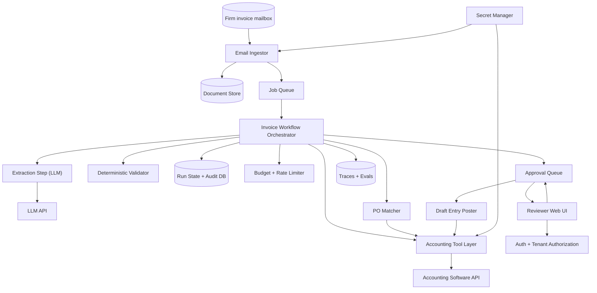

# Invoice Matching Agent for Small Accounting Firms: Architecture

A multi-tenant service for small accounting firms. It watches each client's invoice mailbox, extracts invoice fields with an LLM, matches them against purchase orders in the client's accounting software, flags mismatches (amount, vendor, quantity, duplicates), and creates DRAFT payment entries. A human reviewer must approve before anything is finalized. The job to be done is to remove manual data entry and PO checking while keeping a human in control of every financial posting.

## Diagram

## Components

| Component | Responsibility | Technology |
| --- | --- | --- |
| Email Ingestor | Receives invoice emails via the mail provider's push/webhook or polling (Gmail/Microsoft 365 API), verifies signatures, dedupes by message-id, enforces attachment size/type limits, stores raw files, and enqueues a job. | TypeScript worker; Gmail API / Microsoft Graph with OAuth |
| Document Store | Stores original emails and attachments, encrypted at rest, versioned, with per-tenant prefixes and retention lifecycle rules. | S3-compatible object storage with versioning |
| Job Queue | Durable background execution with bounded retries, backoff, idempotency keys, and a visible dead-letter queue. | Postgres-backed queue (e.g. pg-boss) |
| Invoice Workflow Orchestrator | Runs a deterministic per-invoice workflow (parse, extract, validate, match, flag, draft). Uses the LLM only inside bounded steps; checkpoints after each step so runs resume after failure. | TypeScript state machine |
| Extraction Step (LLM) | Converts invoice PDF/image/text into a schema-validated JSON of fields (vendor, invoice no., dates, line items, totals, tax, PO ref) with per-field confidence. Treats document content as untrusted data and has no tool access. | Claude API with structured output; OCR fallback for scans |
| LLM API | Hosted model provider accessed through a thin provider-agnostic interface. | Anthropic API |
| Deterministic Validator | Checks extracted data in code: line sums equal totals, tax arithmetic, date sanity, currency, duplicate invoice detection (vendor + number + amount). Low-confidence or failed fields route to review. | Zod + plain TypeScript rules |
| Accounting Tool Layer | Typed, least-privilege adapters to the accounting software: read POs/vendors, create draft entries only. Returns structured {code, message, hint} errors, applies timeouts and idempotency keys, and has no post/pay capability. | Adapters for QuickBooks Online / Xero behind one interface |
| Accounting Software API | The client's system of record for POs, vendors and bills (external). | QuickBooks Online / Xero REST API |
| PO Matcher | Matches invoices to POs by PO number, then vendor/amount/date heuristics; performs two-/three-way comparison with configurable tolerances and emits a match result with reasons for any mismatch. Deterministic first; the LLM only suggests candidates when no PO number exists. | TypeScript rules; optional LLM tiebreak |
| Run State + Audit DB | Tenants, users, invoices, checkpoints, match results, approvals, and an append-only audit log of every model input/output, tool call and human decision. Row-level tenant isolation. | PostgreSQL with RLS, PITR backups |
| Budget + Rate Limiter | Per-tenant and global caps on LLM tokens, pages per invoice, invoices per day and per-run steps; alerts at thresholds; stops runaway loops. | Postgres counters + in-process limiter |
| Approval Queue | Holds invoices with match results and proposed draft entries awaiting human decision; tracks approve/reject/edit and enforces that only an approved item triggers posting. | Postgres tables |
| Reviewer Web UI | Shows the source document beside extracted fields and PO, highlights mismatches, and lets accountants edit, approve or reject. Also shows the dead-letter list and per-client settings. | React web app |
| Auth + Tenant Authorization | Bought authentication with SSO/MFA; roles (admin, accountant, viewer) and per-client assignment enforced in one authorization module plus DB RLS; service tokens for workers. | Managed auth provider (Clerk/Auth0/WorkOS) |
| Draft Entry Poster | After approval, writes the draft bill/payment entry to the accounting software using an idempotency key, then records the external id. Reconciles on partial failure. Still creates a draft or unpaid bill, never releases funds. | Queue job using the Accounting Tool Layer |
| Traces + Evals | Structured logs with PII masking, request/run ids, metrics and alerts; replayable traces and a labelled invoice eval set run on each prompt or model change. | OpenTelemetry + hosted log/metrics service; eval harness in CI |
| Secret Manager | Stores OAuth refresh tokens and API keys encrypted, supports rotation, and issues them only to the components that need them. | Platform secret manager / KMS-encrypted DB column |

## Data flow

1. **Firm invoice mailbox → Email Ingestor**: New invoice emails arrive via verified push notification or polling.
2. **Email Ingestor → Document Store**: Raw email and attachments saved after size/type checks.
3. **Email Ingestor → Job Queue**: Enqueues a processing job keyed by message-id plus attachment hash.
4. **Job Queue → Invoice Workflow Orchestrator**: Worker picks up the job; retries are idempotent.
5. **Invoice Workflow Orchestrator → Extraction Step (LLM)**: Sends document content for schema-constrained extraction.
6. **Extraction Step (LLM) → LLM API**: Model call with timeout and token budget.
7. **Invoice Workflow Orchestrator → Deterministic Validator**: Extracted fields are checked for arithmetic, format and duplicates.
8. **Invoice Workflow Orchestrator → PO Matcher**: Validated invoice is compared with candidate POs.
9. **PO Matcher → Accounting Tool Layer**: Read-only fetch of POs and vendors.
10. **Accounting Tool Layer → Accounting Software API**: Authenticated API calls with timeouts and structured errors.
11. **Invoice Workflow Orchestrator → Run State + Audit DB**: Checkpoints after each step and audit entries for all inputs, outputs and tool calls.
12. **Invoice Workflow Orchestrator → Budget + Rate Limiter**: Checks and records token and step spend before each model call.
13. **Invoice Workflow Orchestrator → Approval Queue**: Submits match result, flags and proposed draft entry for review.
14. **Approval Queue → Reviewer Web UI**: Reviewer sees the item with source document and mismatches.
15. **Reviewer Web UI → Auth + Tenant Authorization**: Every request is authenticated and authorized for the tenant and client.
16. **Reviewer Web UI → Approval Queue**: Approve, edit or reject decision recorded with user id.
17. **Approval Queue → Draft Entry Poster**: Approved items enqueue a posting job.
18. **Draft Entry Poster → Accounting Tool Layer**: Creates the draft bill with an idempotency key.
19. **Invoice Workflow Orchestrator → Traces + Evals**: Emits traces and metrics; traces feed replay tests.
20. **Secret Manager → Accounting Tool Layer**: Provides per-tenant OAuth credentials at call time.
21. **Secret Manager → Email Ingestor**: Provides mailbox OAuth credentials.

## Key decisions

### Use a deterministic workflow with LLM steps instead of a free-form tool-calling agent loop

- **Why:** The steps (ingest, extract, validate, match, flag, draft) are known and fixed. A workflow is cheaper, faster, testable and has no runaway-loop risk. The LLM is used only for extraction and optional PO candidate suggestion.
- **Trade-offs:** Less flexibility for odd cases such as unusual documents; those route to human review rather than being solved autonomously.
- **Rejected:** Single autonomous agent with the full toolset; Multi-agent system with extractor, matcher and drafter agents

### The system can only create drafts; it never posts, pays or releases funds, and posting requires a recorded human approval

- **Why:** Financial mistakes are costly and hard to reverse. Enforcing this in the tool layer's capabilities (no pay/post method exists) and credential scopes makes prompt injection unable to move money.
- **Trade-offs:** Humans remain in the loop, limiting full automation; some accounting APIs have no true draft state, so a bill in unpaid/draft status is used.
- **Rejected:** Auto-approve high-confidence matches; Direct payment initiation via bank API

### Deterministic validation and matching in code; LLM output is never trusted for arithmetic or the final match decision

- **Why:** Extraction errors (misread digits) are the main accuracy risk. Recomputing sums, taxes and duplicates in code catches them cheaply and is auditable.
- **Trade-offs:** More rules to maintain and tune tolerances per client.
- **Rejected:** Ask the LLM to decide match/mismatch end to end

### Single Postgres for app data, queue, state and audit log; S3-compatible storage for files

- **Why:** Small-firm scale (hundreds to low thousands of invoices a day) fits one managed Postgres. Fewer moving parts and low idle cost; transactional enqueueing avoids dual-write inconsistency.
- **Trade-offs:** Postgres is a single point of failure and the queue shares capacity with the app; mitigated by managed HA, PITR and a later move to a dedicated queue if needed.
- **Rejected:** Kafka or SQS plus separate stores; Redis-based queue; Microservices

### Buy authentication; enforce tenant isolation by an authorization module plus Postgres row-level security

- **Why:** Accounting firms handle many clients' financial data, so cross-client leakage is the worst security outcome. Two layers (app check and RLS) make a single bug less likely to leak data.
- **Trade-offs:** RLS adds complexity to migrations and testing; auth vendor adds cost and dependency.
- **Rejected:** Custom password auth; Application-only tenant filtering

### Adapter interface over accounting software, starting with one provider (QuickBooks Online), second (Xero) later

- **Why:** Accounting API is the key external dependency; a narrow interface limits lock-in and keeps the matcher independent of vendor data models.
- **Trade-offs:** Lowest-common-denominator abstraction may hide provider-specific features; initial delivery covers only one provider.
- **Rejected:** Hard-code QuickBooks calls throughout; Third-party unified accounting API from day one

### Treat all email and document content as untrusted; the extraction step has no tools and outputs only schema-validated JSON

- **Why:** Invoices come from outside parties and may contain injected instructions. Isolating the model that reads them from any action capability removes the injection impact path beyond wrong field values, which validation and human review catch.
- **Trade-offs:** Cannot let the model dynamically explore data during extraction.
- **Rejected:** Give the extraction model direct read access to the accounting tools

### Idempotency and checkpointing at every external side effect (email message-id dedupe, job keys, draft entry idempotency key with reconciliation)

- **Why:** Mail webhooks and queue retries duplicate events; a duplicated draft bill is a real financial error.
- **Trade-offs:** Extra bookkeeping columns and a reconciliation step after ambiguous failures.
- **Rejected:** Rely on at-least-once semantics and manual cleanup

### Per-tenant budgets and input limits (max attachment size, pages, invoices/day) with alerts

- **Why:** A mailbox flooded with large PDFs or spam would otherwise generate unbounded LLM cost.
- **Trade-offs:** Legitimate bursts (month end) may be delayed and require limit tuning.
- **Rejected:** Unlimited processing with after-the-fact billing review

### Eval set and replayable traces are required before changing prompts or models; model access via a thin provider interface

- **Why:** Extraction accuracy is the product quality; regressions must be caught on labelled invoices. Replay from logged inputs makes incidents debuggable.
- **Trade-offs:** Needs ongoing labelling effort and storing sensitive documents in test fixtures (anonymized).
- **Rejected:** Manual spot checks only

## Risks and pre-mortem

| Risk | Category | Likelihood | Mitigation |
| --- | --- | --- | --- |
| Extraction misreads a number (amount, PO number, bank detail) and a reviewer approves it out of habit, leading to wrong bills; reviewer fatigue grows as automation looks reliable. | data | high | Recompute totals in code, show source-vs-extracted side by side with low-confidence fields highlighted, force re-confirmation of changed vendor bank details, and track per-field correction rates on a dashboard with a weekly eval run on a labelled set. |
| Cross-client data exposure: a bug or an over-scoped accounting token lets a user or the pipeline read another client's POs or invoices. | security | medium | Enforce tenant and client scoping in one authorization module plus Postgres RLS, store one OAuth token per client with minimal scopes, and add automated cross-tenant access tests in CI. |
| Prompt injection or fraudulent invoices (fake vendor, changed bank account, hidden instructions in PDFs) pass through to approval. | security | medium | Keep the extraction model tool-less with schema-only output, flag new vendors and changed bank details and sender-domain mismatches for mandatory review, and have no post/pay capability in the tool layer. |
| Accounting API dependency: QuickBooks/Xero outage, rate limits, token expiry or API/pricing changes stall matching and posting for all clients. | vendor | medium | Use the adapter interface, cache PO snapshots with timestamps, handle token refresh failures with a visible reconnect prompt, queue with backoff, and revisit a second provider or unified API if a single vendor's terms change. |
| LLM cost per invoice grows faster than revenue because of scanned multi-page PDFs, spam floods or retry storms. | cost | medium | Enforce page and size caps, filter non-invoice mail with a cheap classifier before extraction, use a smaller model first with escalation only on low confidence, apply per-tenant daily token budgets with alerts at 70% and 100%, and track cost per invoice as a metric. |

## Open questions

- Assumed scale: 5-50 firms, up to ~2,000 invoices/day total, mostly PDF attachments; revisit if volume is higher.
- Assumed first accounting integration is QuickBooks Online, with Xero second; confirm actual client mix.
- Assumed Gmail and Microsoft 365 are the mailbox providers via OAuth, not IMAP forwarding.
- Assumed 'payment entry' means a draft bill or unpaid payment record in the accounting software, never an actual bank payment.
- Assumed a single human approval is enough; no two-person approval above a threshold (configurable later).
- Assumed a single cloud region with managed Postgres HA and daily backups plus PITR; no multi-region.
- Assumed English-language invoices and common currencies; multi-language and FX handling are out of scope initially.
- Assumed retention of 7 years for invoices and audit records, subject to the firm's local rules; deletion on client offboarding within 30 days except legally required records.
- Assumed GDPR/CCPA basics apply; no HIPAA or PCI. SOC 2 may be requested by firms later.
- Assumed hosted LLM API use is acceptable to firms' clients under a data-processing agreement with zero-training terms.
- Assumed staging and production environments plus local; deploys are rolling with a one-step rollback.
- Assumed three-way matching (goods receipt) is only used if the accounting software already holds receipts; otherwise two-way PO matching.
- Not needed initially: bot and signup-abuse protection beyond provider rate limits, since accounts are invite-only for firm staff; public signup is disabled.
- Not needed initially: search index or analytics warehouse, so deletion only covers Postgres, object storage, backups (expiring by retention window) and the LLM provider (no retention).

## Rules for the coding agent

- Follow this architecture. Components, boundaries and data flow above are the contract.
- If a change requires deviating from it, stop and flag the deviation with the reason instead of silently changing the design.
- Do not add components, services or dependencies that are not listed here without flagging them first.
- Address the mitigations in the pre-mortem as you build the affected components.
- Resolve open questions with the user before building the parts they affect.
