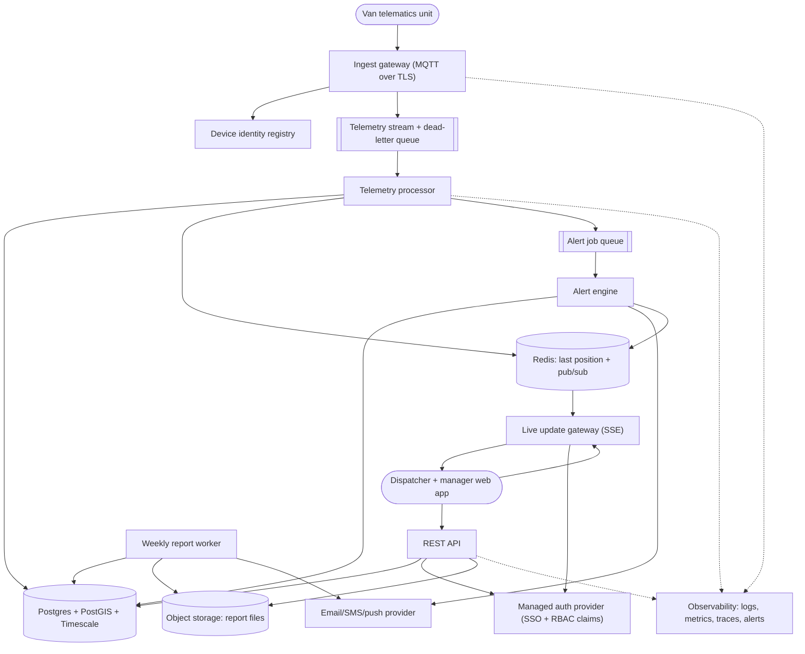

# Fleet Monitoring for 5,000 Delivery Vans: Architecture

Vans send GPS and engine telemetry every 10 seconds (about 500 messages/s, roughly 43M rows/day). Dispatchers see all vans on a live map and receive alerts for engine faults and route deviations. Managers receive weekly utilization reports. The core job is a reliable one-way telemetry pipeline (device to durable stream to storage, live cache and alerts) with a small fan-out layer for the map. Sized for one fleet operator and a single region, using managed services where possible.

## Diagram

## Components

| Component | Responsibility | Technology |
| --- | --- | --- |
| Van telematics unit | Reads GPS and engine codes, buffers locally while offline, and publishes a message every 10 s with a van id, device timestamp and sequence number. Reconnects with jittered backoff and flushes its buffer oldest-first at a capped rate. | Vendor OBD/GPS tracker or in-house firmware, MQTT over TLS |
| Ingest gateway | Terminates TLS, authenticates each device with its own credential, enforces payload size and per-device rate limits, and writes accepted messages to the stream. It does nothing slow and holds no business logic. | Managed MQTT broker (e.g. AWS IoT Core or EMQX Cloud) with rules forwarding to the stream |
| Device identity registry | Stores per-van certificates or tokens, supports revocation and rotation, and maps device to van id so a device can only publish for its own van. | Broker's built-in registry/policies |
| Telemetry stream + dead-letter queue | Durable buffer between ingest and processing so DB slowness or deploys never lose data. Messages that fail validation after bounded retries go to a visible dead-letter queue. | Managed stream/queue (Kinesis, Pub/Sub or SQS class), 7-day retention |
| Telemetry processor | Validates and de-duplicates by (van_id, device_ts), batch-inserts into the DB, updates last-known position in Redis, publishes position updates, and emits alert candidates (fault codes, geofence/route checks) to the alert queue. Idempotent so replays are safe. | Stateless Node.js/TypeScript or Go workers, 2+ instances |
| Postgres + PostGIS + Timescale | System of record: vans, routes, users' fleet settings, raw telemetry hypertable (compressed, 90-day retention), continuous aggregates for daily/weekly utilization, alert history. | Managed PostgreSQL with TimescaleDB and PostGIS, primary + standby, PITR backups |
| Redis: last position + pub/sub | Holds the latest state of each van (about 5,000 small keys) for fast map loads and fans live updates out to gateway nodes. Rebuildable from the DB, so it is a cache and not a source of truth. | Managed Redis |
| Alert job queue | Decouples alert evaluation and notification from ingestion. Jobs carry an idempotency key (van, alert type, episode id) with bounded retries, backoff and a dead-letter queue. | Same managed queue service, separate queue |
| Alert engine | Applies rules with hysteresis: a fault code must persist or a deviation must exceed a threshold for N consecutive samples. Opens and closes alert episodes, de-duplicates, pushes to the live map and sends notifications to on-duty dispatchers. Degrades to in-app alerts only if the notification provider is down. | Worker service, rules in code/config |
| Live update gateway | Pushes position and alert updates to dispatcher browsers, with an initial snapshot from Redis. Checks auth on connect and re-checks on token expiry. Throttles to at most 1 update per van per 10 s and sends viewport-filtered deltas. | Server-sent events (WebSocket fallback), 2+ nodes behind a load balancer |
| REST API | Vans, routes, alert history, trip history, report listing and download, and CSV/JSON export. Enforces authorization in one middleware layer, with pagination caps, input validation and rate limits. | Node.js/TypeScript (Fastify) or equivalent |
| Managed auth provider | Login via email/SSO with MFA, issues short-lived JWTs carrying roles (dispatcher, manager, admin). Bought and not built, with built-in brute-force and credential-stuffing protection. | Auth0, Clerk, Cognito or similar |
| Dispatcher + manager web app | Live map with van status, alert inbox and acknowledgement, trip history, and manager report views. Uses a map tile provider with a usage cap. | React SPA, MapLibre GL with a commercial tile provider |
| Weekly report worker | Scheduled job that reads continuous aggregates (distance, driving/idle hours, utilization %, fault counts), renders a PDF/CSV, stores it, and emails managers a link. Re-runnable for any week and idempotent per (week, report type). | Cron-triggered job, same codebase as API |
| Object storage: report files | Stores generated reports with versioning and a retention lifecycle. Access is via short-lived signed URLs. | S3-compatible bucket |
| Email/SMS/push provider | Delivers alert notifications and report emails. | SES/SendGrid, Twilio or FCM |
| Observability: logs, metrics, traces, alerts | Structured JSON logs with request ids and PII masking. Metrics for stream lag, processor error rate, ingest rate versus expected (silent-van detection), DB saturation, and SSE connection count. On-call alerts only on actionable conditions. | Managed stack (Grafana Cloud, Datadog or CloudWatch) + OpenTelemetry |

## Data flow

1. **Van telematics unit → Ingest gateway**: Telemetry message every 10 s over MQTT/TLS, authenticated per device, with buffered backlog flushed on reconnect.
2. **Ingest gateway → Telemetry stream + dead-letter queue**: Accepted messages are forwarded with van id taken from the authenticated identity, not the payload.
3. **Telemetry stream + dead-letter queue → Telemetry processor**: Batched consumption, acknowledged only after the DB write succeeds.
4. **Telemetry processor → Postgres + PostGIS + Timescale**: Batch insert with ON CONFLICT DO NOTHING on (van_id, device_ts).
5. **Telemetry processor → Redis: last position + pub/sub**: Set last-known state only if the timestamp is newer, then publish an update.
6. **Telemetry processor → Alert job queue**: Alert candidates (fault code present, outside route corridor) with idempotency keys.
7. **Alert job queue → Alert engine**: Jobs consumed with bounded retries and backoff; failures go to the dead-letter queue.
8. **Alert engine → Postgres + PostGIS + Timescale**: Persists alert episodes (opened, acknowledged, closed).
9. **Alert engine → Email/SMS/push provider**: Sends notifications with a provider-side idempotency key and a timeout.
10. **Alert engine → Redis: last position + pub/sub**: Publishes alert events for the live map.
11. **Redis: last position + pub/sub → Live update gateway**: Subscribed position and alert events, plus snapshot reads on client connect.
12. **Live update gateway → Dispatcher + manager web app**: SSE stream of throttled, viewport-filtered van updates and alerts.
13. **Dispatcher + manager web app → REST API**: Queries for history, alert actions, reports and exports using JWT bearer auth.
14. **REST API → Managed auth provider**: JWT signature and claims validation against cached JWKS.
15. **REST API → Postgres + PostGIS + Timescale**: Reads from the standby where possible, writes for settings and alert acknowledgements.
16. **Weekly report worker → Postgres + PostGIS + Timescale**: Reads weekly continuous aggregates.
17. **Weekly report worker → Object storage: report files**: Writes the report file under a deterministic key.
18. **Weekly report worker → Email/SMS/push provider**: Emails managers a signed link to the report.

## Key decisions

### Adapt the realtime-collaboration pattern: keep the gateway + pub/sub + durable log shape, drop the CRDT and rooms

- **Why:** Telemetry is append-only and single-writer per van, so nothing needs merging and the browser never sends edits. What carries over is a durable log written before acknowledgement, a fan-out gateway across nodes via pub/sub, and jittered reconnects with gradual drains. At 500 msg/s the reference's room-affinity routing is unnecessary: every dispatcher sees the same fleet, so any gateway node can serve any client.
- **Trade-offs:** No offline editing or bidirectional sync, which this product does not need. The push channel is one-way, so SSE is enough.
- **Rejected:** CRDT/OT engine: nothing to merge; Room affinity routing: no per-document hotspots to manage; Polling every 10 s: simple, but wasteful at 5,000 vans and laggy for alerts

### Durable managed stream between ingest and processing, with a dead-letter queue

- **Why:** Telemetry must survive DB slowness, deploys and processor crashes. The stream absorbs backlog flushes after cellular outages and allows replay. Bounded retries send poison messages to a visible dead-letter queue instead of blocking the pipeline.
- **Trade-offs:** One more managed component and a few hundred ms of latency, versus direct writes to the DB.
- **Rejected:** Ingest writing straight to Postgres: couples availability and loses data during DB maintenance; Self-hosted Kafka: operational overhead out of proportion to 500 msg/s

### Single Postgres with TimescaleDB and PostGIS for telemetry, geo queries and relational data

- **Why:** 500 inserts/s is comfortable for one tuned instance when batched. Compression, 90-day raw retention and continuous aggregates keep storage and weekly report queries cheap. PostGIS handles route-corridor checks. One database means simple transactions, backups and PITR.
- **Trade-offs:** Vertical scaling limit, with headroom of about 10x. Timescale is an extension and ties us to hosts that support it.
- **Rejected:** Dedicated time-series DB plus Postgres: two systems to run for this volume; NoSQL wide-column store: weak ad-hoc geo and reporting queries

### Redis holds last-known position per van and the pub/sub channel for gateway nodes

- **Why:** The map needs the latest state for 5,000 vans in one fast read, and a snapshot on reconnect avoids hammering the DB. Redis can be rebuilt from the DB and rebuilds itself within one 10 s cycle, so losing it is a brief degradation.
- **Trade-offs:** A second store to keep in sync. Updates are only applied if the timestamp is newer.
- **Rejected:** Querying the DB for the latest row per van on each map load: expensive at scale; In-memory state per gateway node: lost on restart and inconsistent across nodes

### Alerts evaluated with hysteresis and episodes, not per message

- **Why:** GPS jitter and transient fault codes would otherwise flood dispatchers. An alert opens after N consecutive bad samples or a persistent fault code, stays one episode until cleared, and is de-duplicated by (van, type, episode). This also makes retries idempotent.
- **Trade-offs:** Detection delay of a few samples (about 30 s), in exchange for far fewer false alarms.
- **Rejected:** Alert on every violating sample: alert fatigue leads to ignored real faults

### Buy authentication; JWT roles enforced in one API middleware; per-device credentials for vans

- **Why:** A managed provider supplies SSO, MFA and credential-stuffing protection. Roles (dispatcher, manager, admin) are checked in one place, and the SSE gateway validates the same tokens. Each van has its own revocable certificate or token, and the van id is taken from the identity, so one stolen device cannot impersonate others. Service-to-service access uses cloud IAM roles with no long-lived shared keys.
- **Trade-offs:** Vendor dependency and per-user cost. Device provisioning and rotation need an operational process.
- **Rejected:** Self-built login: security burden with no differentiation; One shared API key for all vans: a single leak compromises the fleet

### Traffic and input limits at each edge

- **Why:** The broker enforces per-device publish rate (about 1 message per 5 s sustained) and max payload (e.g. 2 KB). The API enforces per-user rate limits, pagination caps (e.g. 200 rows), and limits on time ranges and export size. Login limits come from the auth provider. SSE caps connections per user. Scraping risk is low because all routes need authentication.
- **Trade-offs:** Limits need tuning, and legitimate bulk exports may need a background-job path.
- **Rejected:** No limits until abuse appears: one buggy device or script can saturate the pipeline

### Weekly reports as a scheduled, idempotent job over continuous aggregates, stored in versioned object storage

- **Why:** Reports take longer than 1 s and call an email provider, so they run in the background. A deterministic key per (week, report) makes re-runs safe, and aggregates mean the job never scans raw telemetry. Late data is handled by recomputing the previous week on a second pass.
- **Trade-offs:** Reports can lag raw data slightly. A re-run after data fixes needs a manual trigger.
- **Rejected:** Computing on demand from raw telemetry: slow and expensive; Dedicated BI/warehouse: unneeded at this size

### Operations baseline: two environments plus staging, rolling deploys, PITR backups, expand/contract migrations

- **Why:** Local, staging and production environments. Stateless services with readiness checks and rolling deploys, with gateway nodes draining gradually to avoid reconnect storms. Managed Postgres with PITR and a quarterly tested restore. Schema changes use expand/contract and avoid long locks on the hypertable. Secrets live in the platform secret manager with a rotation schedule. TLS everywhere, encryption at rest, and automated dependency updates and vulnerability scanning.
- **Trade-offs:** Some setup time and a modest monthly bill for staging and standby.
- **Rejected:** Single environment: risky for a system dispatchers rely on live; Multi-region active-active: over-engineered for this scale

### Data lifecycle: raw telemetry 90 days, aggregates and alert history 2 years, PII masked in logs, export and deletion supported

- **Why:** Van location can reveal driver behavior, so it is treated as personal data. Retention is enforced by Timescale policies, and logs carry van and driver ids but never coordinates or names. Admins can export a driver's or van's data from the API. Driver deletion or anonymization removes the driver-to-van association and is applied to aggregates; backups age out within 35 days. GDPR/CCPA basics apply, and HIPAA/PCI are not applicable. SOC 2 is deferred until customers require it.
- **Trade-offs:** Shorter raw history limits retroactive analysis and disputes beyond 90 days.
- **Rejected:** Keep all raw data forever: storage cost and privacy liability grow without a use case

### Third-party failure handling: degrade rather than fail

- **Why:** If the notification provider is down, alerts still appear in-app and are retried with backoff, then dead-lettered. If the auth provider is down, existing JWTs keep working until expiry via cached JWKS. If the tile provider is down, the map shows a plain background with van markers. Webhooks in are not needed because there is no inbound third-party webhook, and LLM-specific concerns do not apply because the design has no LLM component.
- **Trade-offs:** Degraded modes need explicit testing and UI states.
- **Rejected:** Fail closed on any provider outage: dispatchers lose visibility during incidents

### Single region with a standby DB and stateless multi-instance services; no multi-region

- **Why:** The stream buffers, devices buffer locally, and stateless services scale horizontally, so single points of failure are limited to the primary DB (mitigated by a standby with automatic failover) and the region. Multi-step writes are safe because each is idempotent and acknowledged only after commit, so a half-finished step is replayed.
- **Trade-offs:** A regional outage means downtime; devices buffer and catch up afterward.
- **Rejected:** Multi-region: cost and complexity not justified for a 5,000-van fleet

## Risks and pre-mortem

| Risk | Category | Likelihood | Mitigation |
| --- | --- | --- | --- |
| After a carrier outage or a bad ingest deploy, thousands of vans reconnect together and flush buffered backlogs, so ingest, processors and DB inserts spike far above 500 msg/s and live positions lag by minutes. | scaling | medium | Devices reconnect with jittered backoff and flush backlog at a capped rate, newest data first for the live map. The stream absorbs bursts, and processors autoscale on stream lag with batched inserts. Alert on lag > 60 s, and load-test a 5,000-van, 30-minute backlog before launch. |
| Raw telemetry (about 1.3B rows/month) and map tile usage grow faster than the fleet's revenue, causing storage and tile bills to exceed budget. | cost | high | Enable Timescale compression after 7 days, 90-day raw retention and continuous aggregates. Cap tile loads by clustering vans and throttling updates, set budget alerts on storage and tile spend, and revisit sampling to 30 s for parked vans when monthly storage passes the budget. |
| The map tile/geocoding vendor or managed MQTT broker raises prices sharply or has a long outage, and device firmware and map code are tied to its proprietary APIs. | vendor | medium | Use open standards: MQTT 3.1.1/5 for devices, MapLibre with a swappable tile URL, and raw data in plain Postgres. Keep a documented fallback (self-hosted EMQX, alternate tile provider) and test the tile fallback to a plain background. |
| Late, duplicate, out-of-order or noisy GPS data produces false route-deviation alerts that dispatchers learn to ignore, and utilization reports that quietly under- or over-count distance and hours. | data | high | Dedupe on (van_id, device_ts), use device timestamps with sequence numbers, discard implausible jumps, and apply hysteresis (N consecutive samples plus a corridor buffer) to alerts. Recompute the prior week's aggregates a second time, and track the false-alert rate and silent-van count on a dashboard. |
| A stolen or cloned van credential, or a gap in API authorization, lets an attacker inject fake telemetry or read live and historical locations of drivers. | security | medium | Per-device certificates or tokens with revocation, with the van id derived from the identity and not the payload. Single authorization middleware with role tests, MFA for all users, signed short-lived report URLs, and audit logs for exports. Rotate device credentials on a schedule and when a van is decommissioned. |

## Open questions

- Assumed a single fleet operator (single tenant); multi-tenant isolation is not designed in. Confirm.
- Assumed one cloud region and one timezone for weekly reports (operator's local time, Monday 06:00). Confirm region and timezone.
- Assumed vans carry a telematics unit supporting MQTT over TLS and local buffering; if devices only support HTTPS POST or a vendor cloud, the ingest gateway changes.
- Assumed message payload under 2 KB with position, speed, heading, odometer, fuel/battery and fault codes (DTCs).
- Assumed planned routes are provided by an existing dispatch/routing system or uploaded as polylines; route planning and optimization are out of scope.
- Assumed route deviation means leaving a corridor (e.g. 200 m) for 3 consecutive samples; thresholds are configurable and need business sign-off.
- Assumed about 20-50 concurrent dispatchers and fewer than 20 managers.
- Assumed alert delivery is in-app plus email/SMS to on-duty dispatchers; on-call schedules are managed outside the system.
- Assumed raw telemetry retention of 90 days and aggregates/alerts of 2 years; confirm against legal and customer requirements.
- Assumed driver location is personal data under GDPR/CCPA-style rules; confirm jurisdictions, any works-council or driver-consent requirements, and whether off-duty tracking must be disabled.
- Assumed availability target of 99.9% for ingest and map with up to 5 minutes of data lag acceptable; no formal SLA yet.
- Assumed reports are PDF/CSV delivered by email link; confirm formats and whether a self-service dashboard is also required.
- Assumed a monthly infrastructure budget has not been set; cost ceilings and alert thresholds need a figure.

## Rules for the coding agent

- Follow this architecture. Components, boundaries and data flow above are the contract.
- If a change requires deviating from it, stop and flag the deviation with the reason instead of silently changing the design.
- Do not add components, services or dependencies that are not listed here without flagging them first.
- Address the mitigations in the pre-mortem as you build the affected components.
- Resolve open questions with the user before building the parts they affect.
