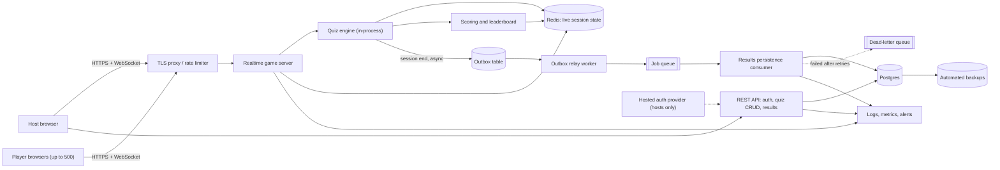

# Classroom Live Quiz: Architecture

A live quiz app for classrooms and events. A signed-in host creates and runs a quiz; up to 500 anonymous players join from phones with a short code, answer each question within 20 seconds, and see a live leaderboard after every question. The core job is low-latency, fair, synchronized question/answer/score rounds for one session at a time per room, with results saved afterward for the host.

## Diagram

## Components

| Component | Responsibility | Technology |
| --- | --- | --- |
| TLS proxy / rate limiter | Terminates TLS, applies per-IP rate limits on join, answer and login endpoints, caps payload sizes and WebSocket connections per IP, serves static frontend. | Managed platform edge or Caddy/nginx; Cloudflare free tier in front |
| Web client (host and player) | Mobile-first SPA: host console (create quiz, start, next question, reveal) and player view (enter code and nickname, answer, see leaderboard). Reconnects automatically and resyncs state. | React or Svelte SPA, native WebSocket with reconnect |
| Realtime game server | Holds WebSocket connections, authenticates host tokens and player session tokens, validates messages, broadcasts question, countdown and leaderboard events per room. Server clock is authoritative for the 20 s timer. | Node.js (TypeScript) with ws or Socket.IO; single instance initially, sticky by room code if scaled |
| Quiz engine | Session state machine (lobby, question open, closed, reveal, finished). Accepts only the first answer per player per question, rejects late answers using server time, enforces host-only controls. | In-process module in the game server |
| Scoring and leaderboard | Computes points (correctness plus speed bonus) and ranks players once per question close; sends top N plus each player's own rank rather than full list to every phone. | In-process, Redis sorted set |
| Live session state (Redis) | Room code to session mapping, current question, answers, scores, player tokens. TTL of a few hours so abandoned sessions expire. Allows server restart recovery. | Managed Redis (small instance) with AOF persistence |
| REST API | Host login session, quiz CRUD, start-session endpoint (issues room code), results retrieval and export, account deletion. | Same Node service as separate module, or separate process |
| Hosted auth provider | Host authentication (email and Google SSO). Players are anonymous and need no account. | Managed auth (Clerk, Auth0 or Supabase Auth) |
| Postgres | Durable data: hosts, quizzes, questions, finished sessions, aggregated per-player results, outbox table. | Managed PostgreSQL with PITR |
| Outbox table and relay worker | Session-finished fact is written to the outbox, and the relay publishes it to the job queue so results are never lost between Redis and Postgres. | Postgres table plus small polling worker |
| Job queue and results persistence consumer | Idempotently writes final scores and answers to Postgres by session id, with bounded retries and backoff; failures go to a dead-letter queue with an alert. Also handles post-session exports. | Postgres-backed queue (pg-boss) to avoid a new broker; swap for SQS if needed |
| Observability | Structured JSON logs without PII beyond nickname, metrics (connected sockets, answer latency, broadcast fan-out time, event-loop lag, memory), alerts on error rate, DLQ depth and outbox age, uptime check on /health and /ready. | Managed logging/metrics (Grafana Cloud free tier or platform built-in), Sentry |

## Data flow

1. **Host browser → REST API**: Host signs in via auth provider, builds a quiz, and starts a session; API creates the session in Redis and returns a 6-digit room code.
2. **Player browsers → Realtime game server**: Player opens a WebSocket, sends room code and nickname, receives a signed player token used on reconnect.
3. **Realtime game server → Quiz engine**: Host commands (start, next, reveal) and player answers are validated and passed to the state machine.
4. **Quiz engine → Live session state (Redis)**: Answers and state transitions are written to Redis; the first answer per player per question wins (atomic set-if-absent).
5. **Quiz engine → Scoring and leaderboard**: When the 20 s timer ends or all players answered, the question closes and scores are computed once.
6. **Scoring and leaderboard → Realtime game server**: Leaderboard results are broadcast: top 10 to everyone, personal rank and score to each player.
7. **Quiz engine → Outbox table**: On session end, final results and a session-finished event are written to the outbox in Postgres.
8. **Outbox relay worker → Job queue**: Unpublished outbox rows are enqueued with the session id as idempotency key.
9. **Results persistence consumer → Postgres**: Idempotent upsert of session results; failures retried with backoff then dead-lettered.
10. **REST API → Postgres**: Host reads past results, exports CSV, and deletes quizzes or account data.

## Key decisions

### Use a WebSocket server with in-memory engine and Redis state, not a full event-driven pipeline, for the live game path.

- **Why:** The live path is request/response and fan-out with a 20 s window and 500 players; the reference architecture explicitly says not to use brokers where users wait on results. A single Node process handles thousands of sockets, so 500 players per room is comfortable.
- **Trade-offs:** Live state is tied to one process per room; scaling horizontally needs sticky routing by room code. Crash recovery relies on Redis state and client reconnect.
- **Rejected:** Kafka/SNS fan-out for in-game events: adds latency and ops with no benefit at this scale; Serverless functions per message: poor fit for long-lived sockets and the timer; Managed realtime service (Pusher/Ably) as the core: considered, but per-connection pricing and vendor lock-in; kept as a fallback

### Adopt the event-driven outbox pattern only for the post-game results path, using a Postgres-backed queue.

- **Why:** Persisting results is async, must not be lost, and benefits from idempotent retries and a dead-letter queue. It adapts the reference outbox, relay and DLQ without a separate broker.
- **Trade-offs:** Adds an outbox table and relay worker; results appear in history a few seconds after the game ends. Postgres queue throughput is ample for this load.
- **Rejected:** Direct write to Postgres at session end with no outbox: loses results if the DB is briefly down; Separate managed broker: extra cost and ops for one consumer

### Server-authoritative timing: the server stamps answer arrival and enforces the 20 s window; clients only display a countdown.

- **Why:** Prevents clock tampering and unfair advantage; speed bonus is computed from server timestamps.
- **Trade-offs:** Players on slow networks lose some milliseconds. Mitigated by a small grace window (about 1 s) and a speed bonus that is gentle.
- **Rejected:** Trust client timestamps: trivially cheatable

### Bought hosted authentication for hosts only; players are anonymous with a nickname and signed room-scoped token.

- **Why:** Removes sign-up friction for 500 phones and minimizes PII held (no player accounts, no emails). Buying auth avoids building password and SSO flows.
- **Trade-offs:** Players cannot keep history across sessions; nickname moderation is needed. Auth vendor dependency for hosts.
- **Rejected:** Player accounts: slows joining and increases privacy burden; Self-built host auth: security risk for little gain

### Redis holds live session state with a TTL; Postgres holds durable data only.

- **Why:** Fast atomic first-answer-wins writes and sorted-set ranking, with state surviving a game server restart mid-quiz.
- **Trade-offs:** Two datastores to run and back up. Live state is deliberately ephemeral and lost if Redis is lost, which is accepted: the host restarts the quiz.
- **Rejected:** Postgres only: more write load during the 20 s answer burst and slower ranking; In-memory only: any deploy or crash kills running games

### Send the leaderboard as top 10 plus the player's own rank, and stagger or batch broadcasts.

- **Why:** Reduces the per-question payload from 500 full lists to one shared message plus small personal messages, and caps bandwidth and CPU spikes at question close.
- **Trade-offs:** Players outside the top 10 do not see everyone around them.
- **Rejected:** Broadcast the full leaderboard to all players: 500 x 500 rows per question

### Deploy as a single region, single game-server instance (plus a warm standby later) on a managed container platform with zero-downtime deploys outside active sessions.

- **Why:** Sized to the stated scale. Deploys drain connections and are blocked or deferred while a session is live; clients reconnect and resync from Redis if a restart occurs.
- **Trade-offs:** Single point of failure for live games, accepted for v1.
- **Rejected:** Multi-region active-active: unjustified complexity and cost

### Cover cross-cutting concerns with defaults: secrets in platform env/secret manager, TLS everywhere, Dependabot plus audit in CI, local and production environments with staging added when a second developer joins, backward-compatible migrations.

- **Why:** Keeps operations cheap while handling commonly forgotten concerns. Service-to-service auth is not needed as API, game server and worker are one deployable sharing a private network and DB credentials. Webhooks in are limited to the auth provider and verified by signature. No LLM features, so LLM-specific concerns are not applicable.
- **Trade-offs:** No staging at first; a bad release is caught only by tests and a canary session.
- **Rejected:** Microservices with mTLS: unnecessary for one small team

### Data lifecycle: nicknames and answers kept 12 months by default, host can delete a session or account, deletion cascades to Postgres and exports; Redis state expires by TTL; logs are retained 30 days and exclude PII.

- **Why:** Classroom use may involve minors, so data minimization matters (COPPA/FERPA/GDPR basics). Backups age out within 35 days, which is documented as the deletion window for backups.
- **Trade-offs:** Short retention limits long-term analytics.
- **Rejected:** Indefinite retention: privacy and liability risk

## Risks and pre-mortem

| Risk | Category | Likelihood | Mitigation |
| --- | --- | --- | --- |
| Question-close thundering herd: 500 answers arrive in the same second and the leaderboard broadcast follows, causing event-loop stalls and missed or late answers on a single Node process, worse if a big event runs several rooms on one instance. | scaling | high | Load test with 500 simulated sockets before launch; batch Redis writes with pipelines, send one shared top-10 message plus small personal ones, track event-loop lag, and shard rooms across instances by room code when a second concurrent large room is common. |
| Game server crash or deploy during a live session drops all connections; reconnection storm and lost state ruin the event for the host. | reliability | medium | Keep authoritative state in Redis, make clients reconnect with jittered backoff and resync from a snapshot, block deploys while sessions are active, and run a rehearsal restart test in CI. |
| Cheating and abuse: players script answers, spoof timing, join with spam bots using guessed room codes, or post offensive nicknames on a projected leaderboard. | security | high | Use 6-digit codes with per-IP join rate limits and lockout, server-side timing and one answer per player, never send the correct answer before close, host can kick players and lock the lobby, and apply a nickname length limit and profanity filter. |
| Results lost or duplicated between Redis and Postgres (outbox relay stalls, consumer bug, schema change), so hosts find missing or double-counted results and nobody notices. | data | medium | Idempotent upsert keyed by session id, alerts on outbox oldest-row age and DLQ depth, a replay command for dead-lettered jobs, and a nightly check that finished sessions have result rows. |
| Dependence on hosted auth and managed Redis: an outage or price rise blocks hosts from starting quizzes or kills live state, and children's data under school privacy rules creates compliance exposure. | vendor | low | Keep auth behind a thin interface using standard OIDC so the provider is swappable, cache host sessions so running games survive an auth outage, use only standard Redis commands, store minimal player data with 12-month retention and deletion tooling, and review privacy terms before targeting schools. |

## Open questions

- Assumed one quiz session per room code and one host per session; co-hosts are out of scope.
- Assumed typical load is a few concurrent sessions with at most one 500-player room at a time; concurrency at the same moment across many events is unknown.
- Assumed players are anonymous (nickname only) with no accounts or cross-session history.
- Assumed question types are multiple choice with one correct answer; free text, images and media uploads are out of scope for v1.
- Assumed hosts authenticate via email or Google through a hosted provider; school SSO is deferred.
- Assumed a single region close to the main audience and no data residency requirement; EU hosting may be needed for GDPR customers.
- Assumed players may include minors, so no player emails or tracking are collected; confirm whether COPPA/FERPA contracts are required.
- Assumed 12-month result retention and 30-day log retention; confirm with customers.
- Assumed scoring is correctness plus a speed bonus; confirm the exact formula and tie-breaking.
- Assumed a budget of low hundreds of dollars a month at launch; confirm cost ceiling.
- Assumed no audio/video, no chat, and no paid tiers or payments in v1.

## Rules for the coding agent

- Follow this architecture. Components, boundaries and data flow above are the contract.
- If a change requires deviating from it, stop and flag the deviation with the reason instead of silently changing the design.
- Do not add components, services or dependencies that are not listed here without flagging them first.
- Address the mitigations in the pre-mortem as you build the affected components.
- Resolve open questions with the user before building the parts they affect.
