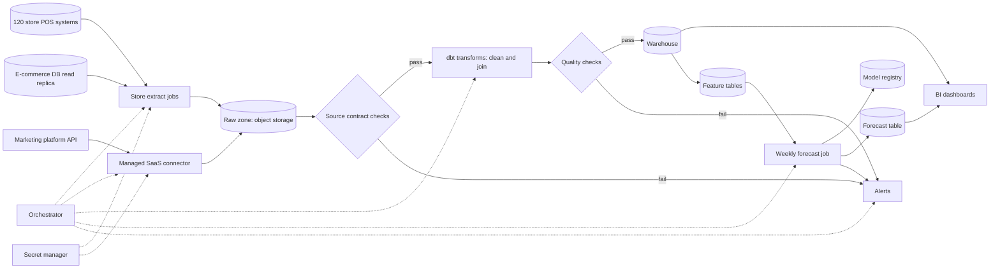

# Retail Nightly Sales Pipeline and Demand Forecast: Architecture

A nightly batch ELT pipeline for a retail chain. It extracts sales from 120 store POS systems, the e-commerce database and a marketing platform, lands the data unchanged in object storage, cleans and joins it with tested dbt models in a warehouse, and publishes it to BI dashboards. A weekly job trains and runs a per-product demand forecast from shared feature tables and writes predictions to a table that dashboards and planners read. Users are analysts, merchandisers and supply planners. Scale is modest (120 stores, nightly), so the design is batch only, with no streaming and no online model serving.

## Diagram

## Components

| Component | Responsibility | Technology |
| --- | --- | --- |
| Store extract jobs | Pull the previous business day's sales from each of the 120 POS systems and the e-commerce read replica, using incremental watermarks. Each store runs as an independent task so one offline store does not block the rest. Writes are idempotent (partitioned by store and date, overwrite on retry). | Python tasks run by the orchestrator; POS access via VPN or an agent at each store, depending on the POS vendor |
| Managed SaaS connector | Sync marketing platform data (campaigns, spend, attribution) into the raw zone without custom code. | Managed ELT connector such as Fivetran or Airbyte |
| Raw zone | Immutable, partitioned copy of source data exactly as received, with versioning enabled. Allows replay and backfills without re-hitting the POS systems. | Object storage (S3/GCS/Azure Blob), Parquet or JSON, lifecycle rules |
| Source contract checks | Validate expected columns, types, store coverage (all 120 stores present) and row-count bounds before transforming. Fails loudly on schema drift instead of coercing. | Great Expectations or dbt source tests with freshness |
| dbt transforms | Clean, deduplicate, normalize (currency, time zones, product IDs) and join POS, e-commerce and marketing data into staging, core and mart models. Incremental models on date partitions. | dbt Core on the warehouse |
| Quality checks | dbt tests plus freshness, row-count and reconciliation checks (for example, daily totals versus store-reported totals). Dashboards and forecast only read data after checks pass; otherwise the previous good data stays published. | dbt tests, elementary or Great Expectations |
| Warehouse | Serves curated models for BI and holds feature tables. Partitioned by date, with budgets and query cost limits. | Managed cloud warehouse (BigQuery, Snowflake or Redshift) |
| Feature tables | Per-product weekly features (lagged sales, promotions, price, stock-outs, seasonality, marketing spend) defined once in a shared SQL/dbt definition used for both training and inference. | dbt models in the warehouse |
| Weekly forecast job | Trains or refreshes per-product demand models, evaluates them against the current champion on a holdout, promotes only if better, and writes next-week forecasts to the forecast table. Falls back to the last good forecast or a seasonal-naive baseline on failure. | Python (LightGBM / statsforecast) run as an orchestrator task |
| Model registry | Versions models, metrics and the feature set used; tracks the champion. | MLflow or the warehouse platform's registry |
| Forecast table | Batch predictions per product, store group and week, with model version and generation timestamp. | Warehouse table |
| BI dashboards | Sales, margin, marketing performance and forecast-versus-actual views. Access via company SSO with role-based access to datasets. | Managed BI tool (Looker Studio, Power BI, Metabase or similar) |
| Orchestrator | Schedules the nightly DAG and the weekly forecast, handles dependencies, bounded retries with backoff, backfills and per-task timeouts, and exposes run history. | Managed Airflow, Dagster or Prefect |
| Alerts | Pages or notifies a named owner on failed or late runs, failed checks, missing stores, forecast accuracy degradation and budget overruns. Failed tasks stay visible in the orchestrator as the dead-letter view. Includes a data-ready-by-time SLA alert. | Slack/email/PagerDuty via orchestrator and warehouse alerting |
| Secret manager | Holds POS, replica, SaaS and warehouse credentials with rotation. Jobs use service accounts or workload identity, with least-privilege roles (read-only on sources). | Cloud secret manager |

## Data flow

1. **120 store POS systems → Store extract jobs**: Nightly incremental pull of sales, returns and voids by business date.
2. **E-commerce DB read replica → Store extract jobs**: Incremental read of orders and line items from a replica, not the primary.
3. **Marketing platform API → Managed SaaS connector**: Scheduled sync of campaigns, spend and attribution.
4. **Store extract jobs → Raw zone**: Write unchanged files partitioned by source, store and date; idempotent overwrite.
5. **Managed SaaS connector → Raw zone**: Land marketing data in the raw zone.
6. **Raw zone → Source contract checks**: Validate schema, coverage and row counts for the night's partitions.
7. **Source contract checks → dbt transforms**: On pass, run incremental staging, core and mart models.
8. **Source contract checks → Alerts**: On fail, notify the owner and keep prior data published.
9. **dbt transforms → Quality checks**: Run tests, freshness and reconciliation before publishing.
10. **Quality checks → Warehouse**: On pass, promote models to the published schema.
11. **Quality checks → Alerts**: On fail, alert and block publishing.
12. **Warehouse → BI dashboards**: Dashboards query published marts.
13. **Warehouse → Feature tables**: Build weekly per-product features from published marts.
14. **Feature tables → Weekly forecast job**: Training and inference read the same feature definitions.
15. **Weekly forecast job → Model registry**: Log candidate model, metrics and promote the champion if it wins the holdout.
16. **Weekly forecast job → Forecast table**: Write next-week forecasts with model version.
17. **Forecast table → BI dashboards**: Forecast and forecast-versus-actual views.
18. **Orchestrator → Store extract jobs**: Schedules and retries extract tasks per store.
19. **Secret manager → Store extract jobs**: Supplies source credentials at run time.

## Key decisions

### Batch ELT with dbt in the warehouse; no Spark

- **Why:** Data volume from 120 stores plus e-commerce is small to medium (millions of rows per day at most). SQL transforms are testable, readable by analysts and cheap to run.
- **Trade-offs:** Very complex per-row logic is harder in SQL; revisit if volume or transforms outgrow the warehouse.
- **Rejected:** Spark/Databricks for transforms; ETL before landing, which loses raw data

### Land raw data unchanged in object storage before any transform

- **Why:** Enables replay, backfills after bug fixes and audit without re-pulling from fragile store POS systems.
- **Trade-offs:** Extra storage cost and one more hop, both small.
- **Rejected:** Load straight into the warehouse

### Custom extract jobs for POS and e-commerce; managed connector for the marketing platform

- **Why:** POS systems are internal or vendor-specific and unlikely to have a connector; the marketing platform is a standard SaaS source where buying beats building.
- **Trade-offs:** Custom extractors need maintenance per POS version. If all stores run the same POS product, one extractor covers all.
- **Rejected:** Custom code for everything; Managed connectors for all sources

### Per-store tasks with partial-failure tolerance and a completeness gate

- **Why:** With 120 stores, some will be offline on any night. Independent tasks isolate failures; a threshold gate (for example, all stores required for finance marts, 95% for dashboards with a visible 'missing stores' banner) avoids blocking everything on one store.
- **Trade-offs:** Dashboards may show partial data with a flag; thresholds need business agreement.
- **Rejected:** All-or-nothing nightly run; Publish whatever arrived without flags

### Publish only after quality checks pass (write-audit-publish)

- **Why:** Wrong numbers on dashboards erode trust faster than late numbers. Previous good data stays visible when checks fail.
- **Trade-offs:** Dashboards can be stale on bad nights; mitigated with a freshness indicator.
- **Rejected:** Publish then fix

### Idempotent partition-overwrite loads keyed on store and business date

- **Why:** Retries and backfills must never duplicate sales. Overwriting a partition is simpler than dedupe merges.
- **Trade-offs:** Late-arriving corrections need a reload window (re-pull the last N days nightly).
- **Rejected:** Append-only loads with downstream dedupe only

### Feature tables in the warehouse via shared definitions; no feature store

- **Why:** One weekly model family with batch inference. Shared dbt feature models prevent training/serving skew without extra infrastructure.
- **Trade-offs:** Add a feature store only if multiple teams or online inference appear.
- **Rejected:** Feast or a managed feature store

### Batch predictions written to a table; no online serving

- **Why:** Forecasts are weekly and consumed by dashboards and planners, with no request-time dependence.
- **Trade-offs:** No on-demand what-if forecasting.
- **Rejected:** Model serving API

### Champion/challenger gate with baseline fallback

- **Why:** Prevents a bad retrain from silently degrading forecasts; a seasonal-naive baseline guarantees an output.
- **Trade-offs:** Slightly more evaluation code.
- **Rejected:** Always deploy the latest model

### Managed orchestrator and managed warehouse, with budgets and alerts

- **Why:** Small team; avoids operating Kubernetes or Airflow clusters. Budget alerts control cost.
- **Trade-offs:** Vendor lock-in and a minimum monthly bill; SQL and Parquet raw data keep exit cost moderate.
- **Rejected:** Self-hosted Airflow on Kubernetes

### Security and privacy by minimization: exclude customer PII from the pipeline

- **Why:** Sales and forecast analysis does not need names or emails. Hash or drop customer identifiers at the extract step, so deletion requests rarely touch the pipeline and PCI scope is avoided (never ingest card numbers).
- **Trade-offs:** Customer-level analysis is not possible without a later design change.
- **Rejected:** Ingest full customer records and mask later

### Operations baseline: environments, deploys, backups, retention, dependency scanning

- **Why:** Local (dbt with a small sample) plus dev and prod warehouse schemas; dbt and pipeline code deployed via CI with tests and rollback by git revert. Warehouse time travel and raw zone versioning serve as backups, with a tested restore. Raw data retained 2 years, logs 30-90 days with no PII. TLS everywhere, encryption at rest by default, Dependabot or equivalent scanning. Not needed: rate limits, bot protection, end-user auth in the app (no public API; dashboards use the BI tool's SSO and roles), webhooks, and LLM-specific controls (no LLM in the design).
- **Trade-offs:** Staging is a schema-level separation rather than a full duplicate stack, to save cost.
- **Rejected:** Full separate staging stack

## Risks and pre-mortem

| Risk | Category | Likelihood | Mitigation |
| --- | --- | --- | --- |
| POS schema or version changes at some of the 120 stores (a vendor update, a store on an old version) silently break or corrupt extracts, so sales are missing or misparsed for some stores. | data | high | Contract checks on columns, types and store coverage before transform; a per-store completeness dashboard; fail loudly rather than coerce; keep a per-store POS version inventory. |
| Nightly run misses the morning SLA because slow or offline stores, the VPN or the POS vendor delay extraction, so dashboards are stale when managers need them. | reliability | high | Independent per-store tasks with timeouts and retries, a completeness threshold that allows partial publishing with a banner, late-store catch-up on the next run, and a data-ready-by-time alert at an agreed hour. |
| Forecast quality degrades unnoticed (promotions, new products, stock-outs censoring demand), leading to wrong replenishment decisions. | data | medium | Weekly forecast-versus-actual tracking per product group, a champion/challenger gate, a seasonal-naive baseline comparison, and an alert when error exceeds baseline; include stock-out flags as features. |
| Warehouse and managed-tool costs grow faster than expected from full-table rebuilds, repeated backfills or unbounded dashboard queries. | cost | medium | Incremental, date-partitioned models; warehouse budgets with alerts and query cost caps; backfill in bounded chunks; review spend monthly. Revisit warehouse choice if spend passes an agreed threshold. |
| Dependence on a single managed warehouse/orchestrator vendor and on the POS vendor's access method; a price rise or outage blocks reporting, and a single credential compromise exposes all sales data. | vendor | low | Keep raw data in open formats (Parquet) and transforms in standard SQL via dbt for portability; read-only least-privilege source credentials in a secret manager with rotation; document a restore and re-run procedure from the raw zone. |

## Open questions

- Assumed all stores run the same POS product and expose either a database or an export API reachable via VPN or an agent; confirm the actual systems and versions.
- Assumed data volume is under about 10 million sales rows per day, so a single managed warehouse is sufficient.
- Assumed the nightly SLA is dashboards ready by 07:00 local time; confirm the required time and time zones.
- Assumed a cloud provider with a managed warehouse; confirm the preferred provider and any existing contracts.
- Assumed forecasts are weekly per product (SKU) at chain level, with an optional store-cluster split; confirm the required granularity and horizon.
- Assumed no customer PII is needed; confirm whether loyalty or customer-level analysis is expected.
- Assumed card payment data is never ingested, keeping PCI scope out; confirm POS exports exclude card numbers.
- Assumed an existing company SSO is available for the BI tool.
- Assumed raw data retention of 2 years and warehouse history of 3 years; confirm legal and finance requirements.
- Assumed a completeness threshold of 95% of stores for dashboard publishing; confirm with the business.
- Assumed a small data team (1-3 people) owns on-call and alert response; confirm ownership.
- Assumed regions are covered by GDPR/CCPA only for customer data, which is excluded; confirm any other compliance obligations.

## Rules for the coding agent

- Follow this architecture. Components, boundaries and data flow above are the contract.
- If a change requires deviating from it, stop and flag the deviation with the reason instead of silently changing the design.
- Do not add components, services or dependencies that are not listed here without flagging them first.
- Address the mitigations in the pre-mortem as you build the affected components.
- Resolve open questions with the user before building the parts they affect.
