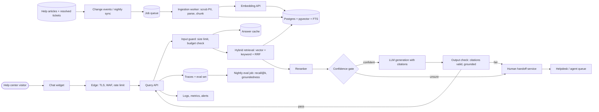

# Help Center Support Assistant (RAG with human handoff): Architecture

An assistant embedded in the public help center that answers customer questions from ~2,000 help articles and past resolved tickets, cites the sources it used, and hands the conversation to a human agent when retrieval confidence is low, the answer fails grounding checks, or the user asks for a person. Load is ~5,000 questions/day (~0.06 qps average, peaks of perhaps 2-5 qps), so the design is a single Postgres with pgvector and a small stateless API, not a distributed search stack. Retrieval quality and safe handoff matter more than model choice.

## Diagram

## Components

| Component | Responsibility | Technology |
| --- | --- | --- |
| Chat widget | Embedded UI in the help center. Shows answers with clickable citations, a 'talk to a human' button, and thumbs up/down feedback. Sends a session id and the page context. | Lightweight JS/React widget served from the help center origin |
| Edge (TLS, WAF, rate limit) | Terminates TLS, applies per-IP and per-session rate limits, blocks obvious bots, and optionally a CAPTCHA challenge after repeated abuse. Expensive endpoint (/ask) gets the strictest limits. | CDN/WAF provider already fronting the help center (e.g. Cloudflare) |
| Query API | Stateless service orchestrating each question: validate input, check cache, retrieve, rerank, gate, generate, verify, respond. Assigns a request id propagated to every step and trace. Streams the answer. | TypeScript (Node) or Python FastAPI on a managed container platform, 2 instances |
| Input guard | Enforces max question length (e.g. 1,000 chars), max turns per session, per-session and global daily token budgets, and strips control characters. Rejects over-budget requests with a handoff or friendly message. | Middleware in Query API; counters in Postgres or Redis |
| Answer cache | Caches final answers for normalized, frequent, context-free questions keyed by normalized query plus corpus version; invalidated when the corpus version changes. Cuts LLM cost for repeat questions. | Redis (small managed instance) or Postgres table with TTL |
| Hybrid retrieval | Runs vector similarity and Postgres full-text search in one query path, merges with reciprocal rank fusion, and filters by visibility (public articles only for anonymous users; tickets only via sanitized derived content). | SQL against pgvector + tsvector |
| Reranker | Re-scores top ~30 candidates and keeps top ~5-6 chunks within a context token cap. Its score feeds the confidence gate. | Hosted rerank API (e.g. Cohere Rerank or Voyage) behind an interface |
| Confidence gate | Decides answer vs handoff using rerank score thresholds, number of supporting chunks, and explicit user escalation intent. Thresholds are tuned on the eval set. | Deterministic code in Query API |
| LLM generation | Produces an answer using only provided chunks, emitting structured output with citation ids, or a 'not found' result. Retrieved text is fenced as data; no tools are exposed. Mid-tier model by default, cheaper model for easy questions. | Hosted LLM API (e.g. Claude Sonnet-class) behind a provider interface, with a fallback model |
| Output check | Validates the JSON structure, verifies every cited id was in the retrieved set, drops unsupported claims or hands off, and blocks links to non-allowlisted domains. | Code in Query API; optional small LLM groundedness check on low-confidence answers |
| Human handoff service | Creates a helpdesk ticket or live-chat transfer with the conversation transcript, the question, retrieved sources and the reason for handoff. Idempotent per session so retries do not create duplicate tickets. Falls back to a contact form if the helpdesk is down. | Helpdesk API integration (e.g. Zendesk/Intercom) executed via the job queue |
| Change events / nightly sync | Receives signed webhooks from the help center CMS and helpdesk (article publish/unpublish, ticket resolved) and runs a nightly reconciliation that diffs source versions vs indexed versions to catch missed events and deletes. | Webhook endpoint with signature verification plus scheduled job |
| Job queue | Durable queue for ingestion and handoff jobs with bounded retries, exponential backoff, and a visible dead-letter table. Jobs keyed by source id + version for idempotency. | Postgres-backed queue (e.g. pg-boss/graphile-worker) to avoid another datastore |
| Ingestion worker | Fetches the source, scrubs PII from tickets (emails, names, phone numbers, order ids, secrets), keeps only the resolution content, parses and chunks at 300-600 tokens with overlap and heading context, embeds, and upserts chunks atomically per document (delete old version + insert new in one transaction). Handles deletes by removing chunks. | Worker process, same codebase as API |
| Embedding API | Turns chunks and queries into vectors. Model name and dimension are stored with each chunk so a model change triggers a full re-embed into a new column or table. | Hosted embedding model behind an interface |
| Postgres + pgvector + FTS | Single source of truth: chunks, embeddings (HNSW), tsvector index, source versions, sessions, budgets, job queue, handoff records. ~2,000 docs plus tickets is well under a few hundred thousand chunks, so one instance suffices. | Managed Postgres with pgvector, automated backups and PITR, one read-only replica optional |
| Traces + eval set | Stores per-request traces (question, retrieved chunk ids, scores, answer, outcome, latency, token cost) with PII masking and 30-90 day retention; feedback and handoffs become labeled eval candidates. | Postgres tables plus an LLM-observability tool (e.g. Langfuse self-hosted or hosted) |
| Nightly eval job | Runs the labeled question set (start with ~150 questions) against retrieval and generation, reporting recall@k, groundedness, correct-handoff rate, and cost; gates chunking, model and prompt changes in CI. | Scheduled CI job / script |
| Logs, metrics, alerts | Structured JSON logs with request id and no raw PII, metrics for latency p50/p95, error rate, handoff rate, cache hit rate, tokens/day, queue depth and dead letters. Alerts on LLM error rate, budget at 80%, ingestion lag, and handoff-rate spikes. | Managed observability (e.g. Grafana Cloud/Datadog) plus uptime check |

## Data flow

1. **Help articles + resolved tickets → Change events / nightly sync**: Publish/update/delete webhooks plus nightly reconciliation of source versions.
2. **Change events / nightly sync → Job queue**: Verified events are stored and enqueued with an idempotency key of source id + version.
3. **Job queue → Ingestion worker**: Worker picks up jobs with bounded retries; failures land in a dead-letter table and alert.
4. **Ingestion worker → Embedding API**: Scrubbed, chunked text is sent for embedding in batches.
5. **Ingestion worker → Postgres + pgvector + FTS**: Chunks, vectors, tsvectors and source version are written in one transaction per document; deletes remove chunks.
6. **Help center visitor → Chat widget**: Visitor types a question.
7. **Chat widget → Edge (TLS, WAF, rate limit)**: HTTPS request with session id; rate limits and bot checks applied.
8. **Edge (TLS, WAF, rate limit) → Query API**: Allowed requests are forwarded with a request id.
9. **Query API → Input guard**: Length, session and daily budget checks.
10. **Input guard → Answer cache**: Lookup by normalized question and corpus version; a hit returns immediately.
11. **Input guard → Hybrid retrieval**: On a cache miss the question is embedded and searched.
12. **Hybrid retrieval → Postgres + pgvector + FTS**: Vector and keyword queries with visibility filter in the SQL, merged by RRF.
13. **Hybrid retrieval → Reranker**: Top ~30 candidates reranked to ~5-6.
14. **Reranker → Confidence gate**: Scores and chunks are evaluated against tuned thresholds.
15. **Confidence gate → LLM generation**: Confident cases go to generation with fenced chunks.
16. **Confidence gate → Human handoff service**: Unsure cases or explicit escalation go to a human.
17. **LLM generation → Output check**: Structured answer with citation ids is validated.
18. **Output check → Query API**: Verified answer with citations is returned and cached if eligible.
19. **Output check → Human handoff service**: Failed validation or ungrounded answer triggers handoff.
20. **Human handoff service → Helpdesk / agent queue**: Idempotent ticket/chat creation with transcript and sources.
21. **Query API → Traces + eval set**: PII-masked trace per request; feedback and handoffs feed the eval set.
22. **Traces + eval set → Nightly eval job**: Labeled questions drive recall and groundedness tracking.
23. **Query API → Logs, metrics, alerts**: Structured logs and metrics with request id.

## Key decisions

### Use pgvector in the existing Postgres instead of a managed vector DB

- **Why:** 2,000 articles plus tickets is far below pgvector limits. One datastore keeps chunks, versions, queue, budgets and traces transactionally consistent and avoids a second sync target.
- **Trade-offs:** Less headroom if the corpus grows to many millions of chunks; HNSW tuning and index memory are our responsibility.
- **Rejected:** Pinecone/Weaviate managed vector DB: extra vendor, sync and cost for no benefit at this scale; Elasticsearch/OpenSearch: heavy to operate for 5k questions/day

### Hybrid retrieval (vector + Postgres FTS with RRF) followed by a reranker

- **Why:** Support questions contain error codes, plan names and exact feature terms that embeddings blur. Reranking is the largest quality gain after chunking and also supplies a calibrated-ish score for handoff.
- **Trade-offs:** Adds ~100-200 ms and a third-party call; mitigated by a fallback to RRF order with stricter handoff thresholds if the reranker is down.
- **Rejected:** Vector-only search: misses exact identifiers; Skipping the reranker: corpus is small but ticket content is noisy, so quality would suffer

### Deviation from the reference: add an explicit confidence gate and human handoff path before and after generation

- **Why:** The requirement is to hand off when unsure. A deterministic gate on retrieval scores plus an output grounding check is cheaper and more predictable than asking the LLM to self-assess, and it saves LLM calls on hopeless queries.
- **Trade-offs:** Thresholds need tuning; too strict inflates agent load, too loose yields wrong answers. Tuned and monitored via the eval set and handoff-rate metric.
- **Rejected:** Rely only on the model saying 'I don't know'; Always answer with a disclaimer

### Deviation from the reference: sanitize tickets into derived content at ingestion instead of per-user ACL filtering

- **Why:** The audience is anonymous help-center visitors, so there are no per-user ACLs. The real leak risk is customer PII and internal notes inside tickets. Only scrubbed resolution summaries are indexed, and chunks carry a visibility flag enforced in the retrieval SQL.
- **Trade-offs:** PII scrubbing is imperfect; summarizing loses some detail. Accepts lower recall from tickets in exchange for safety, with sampled human review of ticket-derived chunks.
- **Rejected:** Index raw tickets and rely on the LLM not to reveal PII; Exclude tickets entirely: loses valuable solutions not in the articles

### Prefer ticket-derived chunks only as supporting evidence, with articles ranked above them and citations to the article when one exists

- **Why:** Articles are authoritative and public-safe; tickets can be outdated or product-version specific. Source-type weighting reduces stale answers.
- **Trade-offs:** Some correct ticket-only answers rank lower; ticket citations show a generic label rather than a link.
- **Rejected:** Treat articles and tickets equally

### Hosted LLM, embedding and rerank APIs behind thin provider interfaces; no self-hosted models

- **Why:** At ~5k questions/day, hosted APIs cost far less than GPU hosting and need no ML ops. Interfaces enable fallback and swapping vendors.
- **Trade-offs:** Vendor dependency and data leaving our network; embedding model changes force a re-embed (cheap at this corpus size).
- **Rejected:** Self-hosted open models on GPUs: idle cost and ops burden

### Incremental, idempotent ingestion via webhooks plus nightly reconciliation, on a Postgres-backed queue

- **Why:** Webhooks give freshness; the nightly diff catches missed events and deletes. A Postgres queue avoids Redis/SQS/Kafka for a few hundred jobs per day. Per-document transactional swap prevents half-indexed documents.
- **Trade-offs:** Postgres queue has lower throughput ceiling than a broker, which is irrelevant here; queue load shares the primary DB.
- **Rejected:** Full re-index nightly: wasteful and creates a window of stale or empty results; Kafka/SQS: over-engineered at this scale

### Treat retrieved text and user text as untrusted data; generation has no tools and output is validated

- **Why:** Tickets and articles can contain injected instructions, and public visitors can attempt jailbreaks. With no tools and strict structured output, the worst case is a bad answer, which the citation check and handoff catch.
- **Trade-offs:** Cannot do actions such as order lookups in this version; those need a separate authenticated design.
- **Rejected:** Give the assistant account-lookup tools: needs authentication and authorization design out of scope for v1

### Cost controls: answer cache, context cap, model routing, and hard per-session and global daily token budgets

- **Why:** An anonymous public endpoint that calls an LLM is a direct cost-abuse target. Estimated cost is roughly $0.005-0.02 per uncached answer (about 3-5k input tokens), so $75-300/month at 5k/day before caching, and caching/routing reduce it.
- **Trade-offs:** Budget exhaustion degrades service to handoff/search-only mode; cache can serve slightly stale answers, mitigated by corpus-version keys.
- **Rejected:** No limits and rely on provider spend caps alone

### Degraded modes for third-party outages

- **Why:** LLM down: show top cited articles as search results plus handoff. Reranker down: use RRF order with stricter thresholds. Embedding down for queries: keyword-only search. Helpdesk down: queue the handoff and show a contact form. Timeouts of ~10 s on generation with one retry and a fallback model.
- **Trade-offs:** More code paths to test; covered by failure-injection tests in the eval harness.
- **Rejected:** Return an error page when any dependency fails

### Authentication: none for visitors; service-to-service uses scoped secrets

- **Why:** The help center is public, so identity is an anonymous session id with rate limits. Webhooks use HMAC signature verification; the API talks to Postgres and vendors with least-privilege credentials held in the platform secret manager. Admin/eval dashboards sit behind company SSO.
- **Trade-offs:** No per-user history or personalization; abuse control relies on IP/session heuristics and CAPTCHA.
- **Rejected:** Require login to chat: hurts deflection and conversion

### Data lifecycle: 30-day retention for raw conversation traces, longer for anonymized eval items; PII masked before logging; deletion by session id

- **Why:** Visitors may type personal data into the chat. Masking before storage, short retention, and a delete-by-session routine address GDPR/CCPA basics. Embeddings contain only help content, so they are not subject to user deletion.
- **Trade-offs:** Shorter retention limits long-term debugging; promoted eval items must be anonymized by a person first.
- **Rejected:** Keep full transcripts indefinitely for analytics

### Operations baseline: local + staging + production, PITR backups with a quarterly restore test, zero-downtime rolling deploys, expand/contract migrations, dependency scanning

- **Why:** Right-sized for a small team: a managed container platform and managed Postgres cover health checks, rollbacks and backups. Index builds use CREATE INDEX CONCURRENTLY.
- **Trade-offs:** Two API instances in one region leaves regional outage risk accepted; handoff form and static help articles remain available since the help center itself is separate.
- **Rejected:** Multi-region active-active: unjustified at 5k questions/day; Kubernetes: unnecessary operational overhead

## Risks and pre-mortem

| Risk | Category | Likelihood | Mitigation |
| --- | --- | --- | --- |
| Silent retrieval misses or confidently wrong answers: a chunking, prompt or model change drops recall, or stale ticket content gets cited, and customers act on incorrect instructions without anyone noticing. | data | high | Build a labeled eval set of ~150 questions before launch (grow it from thumbs-down and handoff logs), run recall@k and groundedness in CI on every change, ship behind a staged rollout, and alert on drops in thumbs-up rate or spikes in 'not found' rate. |
| Cost abuse: the public, unauthenticated endpoint is scripted by bots or scrapers, driving LLM and rerank spend far above the ~$100-300/month estimate within days. | cost | medium | Per-IP and per-session rate limits at the edge, CAPTCHA after threshold, 1,000-char input cap, per-session turn cap, a global daily token budget that flips to search-only/handoff mode, and a spend alert at 80% of budget plus provider-side hard caps. |
| Customer PII or internal notes from resolved tickets leak into indexed chunks and are quoted to other visitors. | security | medium | Index only scrubbed resolution summaries, never raw ticket threads; run regex plus NER PII scrubbing in ingestion, reject chunks that still match PII patterns, review a weekly sample of ticket-derived chunks, and add an output filter for emails/phone numbers. Revisit if ticket volume or sensitivity grows. |
| Index drifts from the source: missed webhooks, failed jobs, or unpublished articles leave deleted or outdated content being cited, and nobody notices because the pipeline fails quietly. | data | medium | Nightly reconciliation that diffs source versions against indexed versions and repairs differences, source version stored per chunk, dead-letter table with an alert, and a freshness metric (max age of unsynced change) with an alert above 24 hours. |
| Dependence on a single hosted LLM provider: an outage, deprecation or price increase stalls answers or breaks quality, and handoff volume floods the human agents. | vendor | medium | Provider interface with a configured fallback model (second vendor or tier), 10 s timeout with one retry, degraded mode that returns top articles plus handoff, an agent-capacity alert on handoff rate, and a pinned model version that is re-validated against the eval set before upgrades. |

## Open questions

- Assumed audience is anonymous public help-center visitors with no login; if customers are authenticated and tickets must be scoped per account, per-user ACL filtering in retrieval is needed.
- Assumed articles are public and English-only; multilingual support would change embedding model, chunking and eval set.
- Assumed the helpdesk (e.g. Zendesk/Intercom) offers an API and webhooks for ticket creation and resolved-ticket events; the actual product is unknown.
- Assumed a hosted LLM, embedding and rerank provider are acceptable for the content and that ticket data may be sent to them after PII scrubbing; confirm with legal/security.
- Assumed a target of ~$300/month or less for LLM spend and p95 latency under 8 s with streaming; confirm budget and latency expectations.
- Assumed human handoff is a helpdesk ticket or live-chat transfer during staffed hours with an email/form fallback; staffing hours and SLAs are unknown.
- Assumed GDPR/CCPA basics apply but no HIPAA/PCI/SOC 2 obligations; confirm, especially if visitors may paste payment or health details.
- Assumed conversation traces are retained 30 days and anonymized eval items kept longer; confirm retention policy.
- Assumed a single region and a managed container platform with managed Postgres; no multi-region or on-prem requirement.
- Assumed a small team (2-4 engineers) with local, staging and production environments.
- Assumed no actions on customer accounts (order lookups, refunds) in v1; the assistant only answers from documentation and hands off for anything account-specific.
- Assumed ~150 labeled eval questions can be produced from existing ticket history and agent knowledge before launch.

## Rules for the coding agent

- Follow this architecture. Components, boundaries and data flow above are the contract.
- If a change requires deviating from it, stop and flag the deviation with the reason instead of silently changing the design.
- Do not add components, services or dependencies that are not listed here without flagging them first.
- Address the mitigations in the pre-mortem as you build the affected components.
- Resolve open questions with the user before building the parts they affect.
