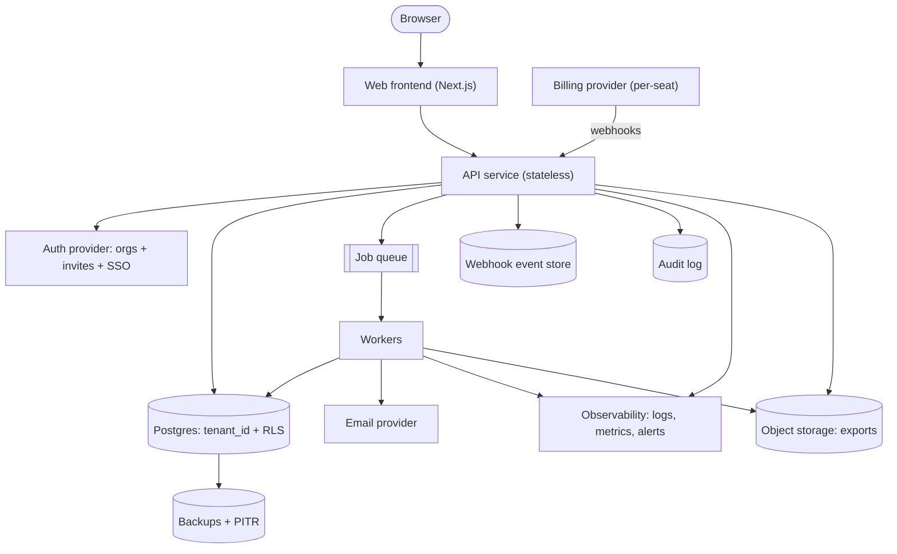

# archpilot OKR Platform: Architecture

A self-serve B2B SaaS where companies set quarterly OKRs (objectives and key results), assign them to teams, and track weekly check-ins. Companies sign up, invite colleagues, and pay per seat. Sized for about 300 companies and 12,000 users in year one. The core job: keep every team aligned on quarterly goals and make weekly progress reporting fast and visible. One shared deployment serves all tenants, with isolation enforced by Postgres row-level security.

## Diagram

## Components

| Component | Responsibility | Technology |
| --- | --- | --- |
| Web frontend | Dashboards for OKR trees, team views, weekly check-in forms, invite and billing settings. Talks only to the API. | Next.js (React, TypeScript) on a managed platform such as Vercel |
| API service | Stateless REST/JSON API. Validates tokens, resolves the active organization, sets the per-request tenant session variable, enforces roles, applies rate limits and input limits, and writes the audit log. Single authorization layer. | Node.js/TypeScript (Fastify or NestJS) container on a managed container platform, 2 instances minimum |
| Auth provider | Email/password and Google login, organizations, invites, roles (owner, admin, member), SSO/SAML for later enterprise customers, MFA, bot and credential-stuffing protection on login. | Managed auth with organizations (Clerk, WorkOS, or Auth0 Organizations) |
| Postgres database | System of record. Tables for organizations, teams, memberships, objectives, key results, check-ins, seat counts. Every table has tenant_id with RLS policies keyed to a session variable. Region stored on the tenant record. | Managed PostgreSQL 16 with PITR, one primary, a read replica added only on trigger |
| Job queue and workers | Run background jobs: weekly check-in reminder emails, quarter-end summaries, billing seat sync, webhook event processing, data export and tenant deletion. Bounded retries with backoff, dead-letter visibility, per-tenant concurrency caps. | Postgres-backed queue (pg-boss) to avoid a new piece of infrastructure; worker container |
| Billing provider | Subscriptions, per-seat quantity, invoices, tax, dunning, customer portal. Sends webhooks on subscription changes. | Stripe Billing (or Paddle as merchant of record if tax handling is a concern) |
| Webhook event store | Stores each incoming billing event with its id and verified signature before processing. Gives idempotency and replay. | Table in Postgres (processed_events) with unique event id |
| Email provider | Transactional email: invites (if not sent by auth provider), reminders, receipts, export-ready notices. | Postmark or Resend |
| Audit log | Append-only record of security- and billing-relevant actions (role changes, invites, deletions, exports, plan changes), per tenant, queryable by admins. | Postgres table with insert-only grants, partitioned by month |
| Object storage for exports | Holds generated CSV/JSON tenant exports under a per-tenant prefix, served by short-lived signed URLs and expired by lifecycle rule. No user file uploads in v1. | S3-compatible bucket with versioning disabled for exports and 7-day lifecycle expiry |
| Observability | Structured JSON logs with request id and tenant id (no PII), metrics for latency, error rate, queue depth and DB saturation, error tracking, uptime checks, and alerts routed to a human on-call. | Sentry plus platform logs/metrics (Grafana Cloud or Better Stack) |
| Backups | Daily automated snapshots, point-in-time recovery, monthly tested restore into a scratch environment. | Managed Postgres backups, 14-day retention |

## Data flow

1. **Browser → Web frontend**: User loads the app over TLS and authenticates through the auth provider's hosted or embedded flow.
2. **Web frontend → API service**: Calls the API with the auth provider's session token; the active organization id is in the token claims.
3. **API service → Auth provider**: Verifies tokens (JWKS, cached) and manages invites and memberships through the provider API with timeouts.
4. **API service → Postgres database**: Each request opens a transaction, sets app.tenant_id from the verified token, and runs queries under an RLS-restricted role with a statement timeout.
5. **API service → Job queue and workers**: Enqueues slow or third-party work (emails, exports, seat sync, deletion) with idempotency keys.
6. **Job queue and workers → Postgres database**: Workers set the tenant context from the job payload before touching tenant data.
7. **Job queue and workers → Email provider**: Sends reminders and notices with a dedupe key so a retry does not send twice.
8. **Billing provider → API service**: Webhook with signature; the API verifies it, stores the event id, returns 200 quickly, and enqueues processing.
9. **API service → Webhook event store**: Inserts the raw event; a unique constraint on the event id drops duplicates.
10. **Job queue and workers → Billing provider**: Pushes seat-count changes when members are added or removed; a nightly job reconciles plan state.
11. **API service → Audit log**: Writes an audit row in the same transaction as the sensitive change.
12. **Job queue and workers → Object storage for exports**: Writes tenant export files under the tenant prefix; the API returns a signed URL.
13. **API service → Observability**: Emits logs, metrics and traces tagged with request id.
14. **Postgres database → Backups**: Continuous WAL archiving and daily snapshots.

## Key decisions

### Shared schema with tenant_id and Postgres RLS, single deployment

- **Why:** Adopts the reference multi-tenant architecture. At 300 tenants and about 12k users, a single Postgres is far below its limits, and one schema keeps migrations simple.
- **Trade-offs:** Isolation depends on RLS being enabled on every table; a cross-tenant test suite is mandatory. Per-tenant restore is harder than with a database per tenant.
- **Rejected:** Schema per tenant: migrations fan out to 300 schemas for no benefit at this scale; Database per tenant: connection and cost explosion

### Buy authentication and organization management

- **Why:** Invites, roles, SSO/SAML, MFA and bot protection are months of work and a security liability if self-built. The provider's organization model maps directly to tenants.
- **Trade-offs:** Per-MAU cost and vendor lock-in on user identities. SSO is often a paid tier.
- **Rejected:** Self-built auth with password hashing and sessions; Open-source self-hosted auth (Keycloak): operations burden for a small team

### Modular monolith API instead of microservices

- **Why:** Sized to the stated scale; a small team ships faster with one deployable. One authorization layer is easier to keep correct.
- **Trade-offs:** Modules must be kept disciplined to allow later extraction.
- **Rejected:** Microservices per domain (OKRs, billing, notifications): operational overhead with no scaling need

### Postgres-backed job queue (pg-boss) rather than Redis/SQS

- **Why:** Job volume is low (reminders, exports, webhook processing). Reusing Postgres removes a service, gives transactional enqueue with the business write, and avoids idle cost.
- **Trade-offs:** Queue load shares the primary database; heavy job bursts could compete with API queries. Move to a dedicated queue if jobs exceed a few hundred per second.
- **Rejected:** Redis + BullMQ: extra infrastructure to run and back up; SQS: extra IAM and local-dev complexity for this volume

### Authorization in one API middleware layer on top of RLS, with three roles

- **Why:** RLS guarantees tenant isolation; role checks (owner, admin, member) and team-level edit rights are enforced in one policy module. Members edit their own key results and check-ins; admins manage teams and OKRs; owners manage billing.
- **Trade-offs:** Per-object ACLs are not supported in v1; custom roles are deferred.
- **Rejected:** Per-object permission lists: complexity not justified by the product; Role checks scattered in handlers

### Per-seat billing via Stripe with webhook-driven state

- **Why:** Seat count equals active memberships. The app stores plan state only from verified webhooks and reconciles nightly, so billing drift is detected.
- **Trade-offs:** Entitlements lag briefly behind payment events; a grace period for failed payments is required.
- **Rejected:** Custom invoicing: tax and dunning are not worth building; Updating plan state directly from the client redirect

### Service-to-service auth by network isolation and a separate DB role for workers

- **Why:** API and workers are one codebase on a private network; workers use their own DB credentials and receive tenant id in job payloads. There are no other internal services in v1.
- **Trade-offs:** Workers run with broader DB privileges than the API, so job payload tenant ids must be trusted only from the enqueue path.
- **Rejected:** mTLS or service tokens between internal services: nothing to connect yet

### Managed platform deployment with staging, no Kubernetes

- **Why:** Local, staging and production environments on a container PaaS give rolling zero-downtime deploys, readiness checks and one-click rollback. Expand-then-contract migrations avoid table locks.
- **Trade-offs:** Less control and higher unit cost than self-managed infrastructure; acceptable at this size.
- **Rejected:** Kubernetes: operational overhead with no benefit at 12k users

### Soft-delete then hard-delete tenants through a deletion job

- **Why:** Account deletion marks the tenant, cancels the subscription, and a job removes tenant rows, export files and auth organization after a 30-day grace. Backups age out in 14 days, so full removal completes within about 45 days; this is stated in the privacy policy.
- **Trade-offs:** Data persists in backups for up to 14 days after deletion.
- **Rejected:** Immediate hard delete: no recovery from accidental deletion; Rewriting backups: impractical

### No LLM features in v1

- **Why:** The product does not require them, so prompt injection, tool permissions and token cost are not applicable. If AI summaries are added later, they need a per-tenant token budget and output validation.
- **Trade-offs:** Forgoes a likely competitive feature in the short term.
- **Rejected:** Shipping AI check-in summaries at launch

### Rate and input limits at the API with a per-tenant and per-IP budget

- **Why:** Limits on login, invite, export and write endpoints; page size capped at 100; request body capped at 1 MB; invite count capped per day per tenant to stop spam relay. Bot protection on signup via the auth provider.
- **Trade-offs:** In-memory counters per instance are approximate; a shared store is needed if instances multiply.
- **Rejected:** No limits until abuse appears

### Secrets, encryption and dependency hygiene via platform defaults

- **Why:** Secrets live in platform secret storage with a documented rotation plan; TLS everywhere; managed Postgres and storage encrypted at rest; Dependabot plus vulnerability scanning in CI. Logs carry ids, not names or emails.
- **Trade-offs:** No application-level field encryption; OKR content is business-sensitive but not regulated.
- **Rejected:** Per-tenant encryption keys: complexity without a customer demand

### Degraded-mode behavior for third-party outages

- **Why:** Auth outage: existing short-lived tokens keep working, new logins fail. Billing outage: app continues on last known plan state. Email outage: jobs retry with backoff and land in the dead-letter view. All outbound calls have timeouts.
- **Trade-offs:** Brief windows of stale entitlements or delayed emails.
- **Rejected:** Failing requests when a vendor is unreachable

## Risks and pre-mortem

| Risk | Category | Likelihood | Mitigation |
| --- | --- | --- | --- |
| A missing RLS policy on a new table or a worker that skips setting the tenant context leaks one company's OKRs to another. | security | medium | CI check that fails if any table with tenant_id lacks RLS; automated test that calls every endpoint as tenant A with tenant B's ids; API uses a non-owner DB role that cannot bypass RLS. |
| Billing drift: a missed or duplicate Stripe webhook leaves seats or plan state wrong, so customers get free access or are wrongly locked out. | data | high | Verify signatures, store event ids with a unique constraint, process asynchronously, run a nightly reconciliation against Stripe, and alert on any mismatch above zero. |
| Weekly check-in deadlines make traffic spike (Monday mornings, quarter start) and reminder emails fire at once, saturating the single Postgres that also hosts the queue. | scaling | medium | Spread reminders across a time window by tenant timezone, cap per-tenant job concurrency, set statement timeouts and index check-in queries; add a read replica for dashboards and move the queue to a dedicated service if queue depth alerts fire repeatedly. |
| Dependence on one auth provider: a price rise at SSO tiers or an outage blocks all logins, and user identities are hard to migrate. | vendor | medium | Keep provider user and org ids in our own tables behind a thin auth adapter, export users regularly, use short-lived tokens that survive brief outages, and revisit when the provider bill passes a set share of revenue. |
| Per-seat vendor and infrastructure costs (auth MAU pricing, managed Postgres, logs) grow faster than revenue on small or inactive tenants, and free signups are abused. | cost | medium | Require a trial with card or email verification and signup bot protection, cap invites per day, set log retention and sampling, set budget alerts on each vendor, and review cost per seat monthly against price. |

## Open questions

- Assumption: web app only, no native mobile apps; the UI is responsive.
- Assumption: roles are owner, admin and member; no custom roles or per-object ACLs in v1.
- Assumption: all customers are in one region (for example US or EU); region is stored per tenant for a later second deployment.
- Assumption: no SOC 2 or HIPAA at launch; GDPR/CCPA basics are covered through export, deletion and a DPA. SOC 2 Type 1 is likely wanted within 12 months for larger buyers.
- Assumption: SSO/SAML is sold as an enterprise add-on, not needed at launch.
- Assumption: Slack, Jira and other integrations and a public API are out of scope for v1.
- Assumption: no file uploads; only generated exports use object storage.
- Assumption: pricing is a flat monthly per-seat price with a free trial; no usage-based billing.
- Assumption: target availability is 99.5 percent with a single region and no multi-region failover; RPO of 5 minutes and RTO of a few hours.
- Assumption: a small team (2 to 5 engineers) runs on-call with business-hours escalation.
- Assumption: no LLM features in v1.
- Assumption: audit log retention is 1 year; application logs 30 days; exports expire after 7 days.

## Rules for the coding agent

- Follow this architecture. Components, boundaries and data flow above are the contract.
- If a change requires deviating from it, stop and flag the deviation with the reason instead of silently changing the design.
- Do not add components, services or dependencies that are not listed here without flagging them first.
- Address the mitigations in the pre-mortem as you build the affected components.
- Resolve open questions with the user before building the parts they affect.
