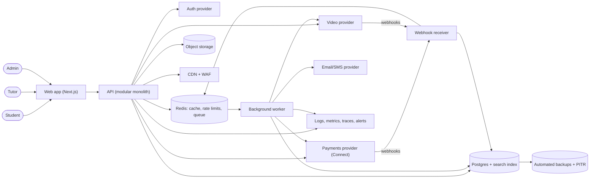

# Tutor Marketplace: Architecture

A two-sided marketplace where students search tutors by subject and price, book and pay for sessions, attend video lessons through a third-party provider, and leave reviews. Tutors are paid out after each completed session minus a platform commission. Sized for an early-stage launch (low thousands of users, tens of bookings per minute at peak), so it is a modular monolith on managed services. The RAG reference architecture was adapted only partly: the 'hybrid retrieval over a single datastore' idea becomes Postgres full-text search plus structured filters, with no LLM, embeddings or reranker in v1.

## Diagram

## Components

| Component | Responsibility | Technology |
| --- | --- | --- |
| Web app | Responsive UI for students, tutors and admins: search, tutor profiles, booking, checkout, lesson room embed, reviews, tutor dashboard and payout status. | Next.js (React, TypeScript) |
| CDN + WAF | TLS termination, caching of static assets and public tutor pages, basic bot and DDoS filtering, edge rate limiting on login and signup. | Cloudflare or platform-provided CDN/WAF |
| API (modular monolith) | Single deployable with modules: users/profiles, search, availability and booking, payments orchestration, lessons, reviews, payouts, admin. Enforces authorization in one policy layer, input limits and pagination caps. | Node.js/TypeScript (NestJS or Fastify) on a managed container platform |
| Auth provider | Email/password, Google social login, MFA, password reset, session/JWT issuance. Roles (student, tutor, admin) are stored in our DB and checked by the API. | Managed auth (Auth0, Clerk or Cognito) |
| Primary database | Source of truth for users, tutor profiles, availability, bookings, payments ledger, reviews, payouts, processed webhook events and audit log. Also hosts full-text and filter search via tsvector and indexes. | Managed PostgreSQL with PITR and one read replica later |
| Redis | Job queue, rate-limit counters, short-lived booking slot holds, hot search/profile cache. | Managed Redis (BullMQ for jobs) |
| Background worker | Runs slow or third-party work: payment capture/refund, transfers to tutors, emails/reminders, video room creation, review prompts, data export and deletion jobs. Bounded retries with backoff and a visible dead-letter queue. | Node.js worker process, same codebase as API |
| Webhook receiver | Verifies signatures on payment and video provider webhooks, stores the raw event with its provider event id (dedupe), returns 200 fast, and enqueues processing. | Route in the API, separate rate limit and path |
| Payments provider | Card collection (PCI scope stays with the provider), escrow-like hold, tutor onboarding/KYC, commission split and payouts, refunds, tax forms where supported. | Stripe Connect (separate charges and transfers) |
| Video provider | Hosts lessons: room creation, short-lived join tokens per participant, attendance/duration events. Recording off by default. | Daily, Twilio Video alternative, or Zoom SDK behind an adapter |
| Email/SMS provider | Booking confirmations, reminders, receipts, payout notices. | Postmark or SES (SMS via Twilio only if needed) |
| Object storage | Tutor avatars, credential documents and exports, with versioning, private by default and signed URLs. | S3-compatible bucket |
| Observability | Structured JSON logs with request id and PII masking, metrics (latency, error rate, queue depth, webhook lag), traces, error tracking, and alerts on payment failures, DLQ growth and payout mismatches. | Managed stack (Sentry + Grafana Cloud or Datadog) |
| Backups | Daily snapshots plus point-in-time recovery for Postgres, bucket versioning, quarterly tested restore. | Managed DB backups |

## Data flow

1. **Student → Web app**: Searches by subject, price, rating and availability; views tutor profiles.
2. **API (modular monolith) → Primary database**: Search query uses full-text plus filters; booking creates a pending row inside a transaction with a unique constraint on tutor and time slot.
3. **API (modular monolith) → Payments provider**: Creates a PaymentIntent with an idempotency key tied to the booking id; student confirms in the browser.
4. **Payments provider → Webhook receiver**: payment_succeeded/failed events are signature-verified, stored by event id, and enqueued.
5. **Background worker → Primary database**: Marks booking confirmed, writes ledger entries (gross, commission, tutor share), schedules reminders.
6. **Background worker → Video provider**: Creates the room shortly before the session; API issues per-user join tokens to the booked student and tutor only.
7. **Video provider → Webhook receiver**: Meeting started/ended events with durations update lesson status.
8. **Background worker → Payments provider**: After lesson completion and a dispute window (e.g. 24h), creates a transfer to the tutor's connected account minus commission, idempotently.
9. **Background worker → Email/SMS provider**: Sends confirmations, reminders, review prompts and payout notices with dedupe keys.
10. **Student → API (modular monolith)**: Posts a review, allowed only for a completed booking owned by that student, one per booking.
11. **Primary database → Backups**: Continuous WAL archiving and daily snapshots.
12. **API (modular monolith) → Observability**: Logs, metrics and traces carrying a request id, also propagated to worker jobs.

## Key decisions

### Modular monolith with a separate worker process, not microservices

- **Why:** Scale is small and one team; one codebase, one database and transactional booking logic are simpler and cheaper. Module boundaries keep later extraction possible.
- **Trade-offs:** Deploys are coupled and a bad module can affect everything; mitigated by feature flags and fast rollback.
- **Rejected:** Microservices per domain; Serverless functions per endpoint

### Postgres full-text search plus filters instead of a vector DB or search cluster; no LLM/RAG in v1

- **Why:** Search is structured (subject, price, rating, availability) with short profile text. Postgres handles it at this scale and avoids a second source of truth. This deviates from the RAG reference, whose embeddings, reranker and LLM add cost and failure modes with no v1 need.
- **Trade-offs:** Weaker fuzzy/semantic matching and ranking; revisit with Elasticsearch/Typesense or pgvector if search quality metrics show misses or catalog exceeds a few hundred thousand tutors.
- **Rejected:** Elasticsearch/OpenSearch from day one; pgvector semantic search; LLM tutor matching

### Stripe Connect with separate charges and transfers; platform holds funds until lesson completion

- **Why:** Offloads PCI, tutor KYC, payouts and tax reporting, and allows commission, refunds and a dispute window before transfer.
- **Trade-offs:** Vendor lock-in and fees; holding funds has regulatory and country-coverage limits.
- **Rejected:** Direct charges to tutors (no hold or refunds control); Building payouts via bank transfers ourselves; PayPal Payouts only

### Buy auth; roles and per-object authorization live in our API policy layer

- **Why:** Auth is a solved problem; ownership checks (own bookings, own payouts) must be in one place to avoid IDOR bugs.
- **Trade-offs:** Per-user cost and some lock-in; mitigated by keeping user ids and roles in our DB.
- **Rejected:** Self-built password auth; Provider-only roles with no in-app policy layer

### Video behind a thin adapter interface, buying a hosted SDK

- **Why:** WebRTC infrastructure is costly to run; an adapter lets us swap providers if prices or reliability change.
- **Trade-offs:** Lowest-common-denominator features and per-minute cost.
- **Rejected:** Self-hosted WebRTC (LiveKit/Jitsi) in v1; Sending users to external Zoom links

### Ledger table in our DB as the record of money, reconciled daily with the payments provider

- **Why:** Commission, refunds and payouts need an auditable trail independent of provider dashboards, and reconciliation detects drift.
- **Trade-offs:** Extra code and a nightly job.
- **Rejected:** Relying only on provider data; Storing mutable balance columns

### Booking uses a short slot hold and a DB unique constraint to prevent double-booking

- **Why:** Two students can race for one slot; the constraint is the final arbiter, with Redis hold giving a good UX during checkout.
- **Trade-offs:** Expired holds need cleanup; abandoned checkouts briefly block slots (10-15 min TTL).
- **Rejected:** Optimistic UI with no hold; Distributed locks only

### All third-party calls and slow work go through the queue; webhooks are stored then processed asynchronously with event-id dedupe

- **Why:** Meets idempotency, retry and outage requirements; provider downtime degrades to delayed processing instead of failed requests.
- **Trade-offs:** Eventual consistency; the UI must show pending states.
- **Rejected:** Synchronous provider calls in request handlers; Processing webhooks inline

### Single region, managed Postgres with PITR, one environment each for local, staging and production

- **Why:** Right-sized availability for launch; multi-region would double cost and complexity.
- **Trade-offs:** Regional outage means downtime; recovery relies on restore. Accepted for v1.
- **Rejected:** Multi-region active-active; Self-managed Postgres

### Privacy by design: PII masked in logs, deletion and export jobs, retention schedule, provider data-processing agreements

- **Why:** Users may include minors and are in several jurisdictions; GDPR/CCPA requests must be met within about 30 days. Financial records are retained as legally required and anonymized otherwise.
- **Trade-offs:** Deletion is partly anonymization; backups age out after 35 days rather than being rewritten.
- **Rejected:** Manual deletion handled by support; Keeping all data indefinitely

### Security baseline: secrets in platform secret manager, TLS, encryption at rest, Dependabot plus vulnerability scanning, upload type/size limits, rate limits on login, search, booking and webhooks

- **Why:** Cheap controls cover the common abuse paths: credential stuffing, scraping and spam signups.
- **Trade-offs:** Some friction for legitimate heavy users; CAPTCHA on signup only when abuse is detected.
- **Rejected:** Defer abuse controls until after launch

## Risks and pre-mortem

| Risk | Category | Likelihood | Mitigation |
| --- | --- | --- | --- |
| Money drift: duplicate or missed webhooks, partial failures between payment capture, booking confirmation and tutor transfer leave students charged without a booking, or tutors unpaid or overpaid. | data | high | Idempotency keys on every provider call, processed-event table, state machine for bookings, daily reconciliation job against provider with alerts on any mismatch, and a runbook for manual correction. |
| Payments provider (Stripe Connect) account is restricted or held, or tutor KYC and country coverage block payouts, freezing revenue and tutor funds. | vendor | medium | Keep an internal ledger and clean provider integration behind a payments interface, comply with provider terms on fund holding, maintain a relationship contact, and revisit a second provider when monthly volume passes an agreed threshold. |
| Off-platform leakage: tutors and students move bookings outside the platform after first contact, so commission revenue collapses. | other | high | No direct contact details or free-form messaging before payment, in-app messaging scanned for contact details, rebooking incentives and tutor tooling (recurring packages), and a metric on repeat-booking rate to detect leakage. |
| Video minutes and fees grow faster than commission revenue (long or no-show sessions, free trial lessons), making unit economics negative. | cost | medium | Cap session length and auto-end rooms, create rooms only for paid bookings, track video cost per booking against commission, set provider budget alerts, and adjust commission or minimum prices when margin falls below target. |
| Authorization bug (IDOR) lets a user read or modify another user's bookings, payout details, tutor credential documents or join another lesson room. | security | medium | Central policy layer with tests per resource, private bucket with short-lived signed URLs, per-booking video join tokens, no card data stored, and an external pentest before public launch. |

## Open questions

- Assumed launch scale: up to about 5,000 tutors, 50,000 students and 100 concurrent lessons; revisit if far higher.
- Assumed a single launch currency and country with Stripe Connect support; multi-currency and cross-border payouts are out of scope for v1.
- Assumed commission is a flat percentage (15%) set by config, with no tiered rates or promotions.
- Assumed funds release 24h after lesson completion unless a dispute is opened; refund and cancellation policy needs business confirmation.
- Assumed tutors are vetted by manual admin approval, with identity checks done via the payments provider KYC.
- Assumed lessons are one-to-one, with recording off by default and no in-platform chat beyond booking messages.
- Assumed users may be minors under 18 only through a parent account; legal review of age and consent rules (COPPA/GDPR-K) is needed.
- Assumed web only (responsive); native mobile apps are deferred.
- Assumed English-only UI and tutor-set timezone-aware availability calendars with no external calendar sync in v1.
- Assumed retention: application logs 30 days, backups 35 days, financial records 7 years, deleted accounts anonymized within 30 days.
- Assumed no LLM features in v1; AI-based matching or lesson summaries would need a separate design with prompt-injection and cost controls.
- Assumed tutor payouts are on a rolling schedule rather than on demand; needs confirmation.

## Rules for the coding agent

- Follow this architecture. Components, boundaries and data flow above are the contract.
- If a change requires deviating from it, stop and flag the deviation with the reason instead of silently changing the design.
- Do not add components, services or dependencies that are not listed here without flagging them first.
- Address the mitigations in the pre-mortem as you build the affected components.
- Resolve open questions with the user before building the parts they affect.
