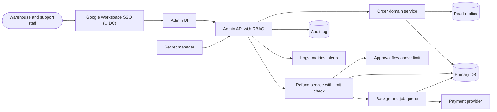

# Order Support Admin Tool: Architecture

An internal web app for about 60 warehouse and support staff to look up orders, change shipping addresses, issue refunds up to a role-based limit, and view an immutable audit trail of every change. Login is via the company Google Workspace. The main risks are wrong changes, excess access and missing trail, not scale. All writes go through the existing order and refund domain logic rather than raw SQL.

## Diagram

## Components

| Component | Responsibility | Technology |
| --- | --- | --- |
| Google Workspace SSO | Authenticates staff via OIDC restricted to the company domain (hd claim checked server-side). Group membership or an app-side user table maps people to roles. Offboarding in Workspace removes access. | Google OIDC, authorization code flow with PKCE |
| Admin UI | Order search, order detail, address edit form, refund form, audit trail viewer. Masks sensitive fields (card data absent, phone and email partially masked) by default with an explicit reveal that is audited. Confirmation step on every write. | React SPA or server-rendered app served from the same origin as the API |
| Admin API with RBAC | Single enforcement point for authentication sessions, role checks (support, warehouse, refund-approver, auditor), input validation, pagination limits, rate limits and request ids. Every mutating call writes an audit entry. | Node/TypeScript or the product's existing backend language; one container |
| Order domain service | Validates and applies shipping address changes using the product's own business rules (e.g. not allowed after shipment). Reads order search from the replica with query timeouts. | Shared module or call to the product's internal API |
| Refund service with limit check | Enforces per-role and per-order refund limits, cumulative daily limits per staff member, and cannot exceed the amount paid minus prior refunds. Requires a reason code. Uses an idempotency key per refund request. | Domain module with limits in config table |
| Approval flow above limit | Refunds over the limit become pending requests that a different person with the approver role must approve. Requester cannot approve their own. Notifies approvers by email or chat. | Pending-request table plus simple approve/reject endpoint |
| Background job queue | Executes the payment provider refund call and notification emails asynchronously with idempotency keys, bounded retries with backoff and a visible dead-letter list. | Postgres-backed queue (e.g. pg-boss) to avoid new infrastructure |
| Primary DB | Order data, refund records, pending approvals, user-role mappings. Order changes and their audit entry are written in one transaction. Daily backups plus point-in-time recovery. | PostgreSQL (managed) |
| Read replica | Serves order search and detail reads so admin queries cannot slow customer traffic. Statement timeout set. | Managed PostgreSQL replica |
| Audit log | Append-only record of who, when, what, before and after values, reason, request id and outcome for every change and every sensitive-field reveal. App DB role has insert and select only. Retained 7 years by default; PII in diffs limited to changed fields. | Append-only Postgres table with revoked UPDATE/DELETE, nightly export to versioned object storage |
| Payment provider | Executes the actual refund. Outage leaves jobs queued and visible rather than lost. | Existing company payment provider API |
| Logs, metrics, alerts | Structured JSON logs with request id and PII masked, latency and error metrics, alerts on dead-letter growth, refund failures, unusual refund volume per user and auth failures. | Platform logging plus a managed metrics/alerting service |
| Secret manager | Holds OIDC client secret, DB credentials, payment API key and session signing key. Rotated at least yearly and on staff departure of anyone with access. | Cloud secret manager or platform env vars |

## Data flow

1. **Warehouse and support staff → Google Workspace SSO**: Staff sign in with their company Google account.
2. **Google Workspace SSO → Admin UI**: ID token validated by the API, which issues a short-lived HttpOnly session cookie.
3. **Admin UI → Admin API with RBAC**: HTTPS requests with CSRF protection; search, view, edit address, request refund.
4. **Admin API with RBAC → Order domain service**: Authorized order reads and address changes.
5. **Order domain service → Read replica**: Search and detail reads with timeouts and capped page sizes.
6. **Order domain service → Primary DB**: Address update plus audit insert in one transaction.
7. **Admin API with RBAC → Refund service with limit check**: Refund request with idempotency key and reason code.
8. **Refund service with limit check → Approval flow above limit**: Refunds over the limit become pending and wait for a second person.
9. **Refund service with limit check → Background job queue**: Within-limit or approved refunds are enqueued in the same transaction as the refund record and audit entry.
10. **Background job queue → Payment provider**: Refund call with provider idempotency key; retries with backoff.
11. **Background job queue → Primary DB**: Records refund result; failures go to the dead-letter list.
12. **Admin API with RBAC → Audit log**: Audit entry for every mutation and sensitive reveal.
13. **Admin API with RBAC → Logs, metrics, alerts**: Structured logs and metrics with request id.

## Key decisions

### Build a small custom app rather than a low-code builder

- **Why:** Refund limits, approvals and transactional audit entries are custom workflows, and Google SSO plus RBAC must be enforced in one place. At 60 users either is affordable, but custom keeps writes going through domain logic.
- **Trade-offs:** Longer initial build than low-code and the team owns maintenance.
- **Rejected:** Retool or similar low-code with direct DB connection; Direct SQL console for support staff

### Authenticate with Google Workspace OIDC; do not build passwords or MFA

- **Why:** Required by the brief. Workspace already provides MFA, offboarding and domain restriction. Buying avoids credential stuffing and password reset concerns entirely.
- **Trade-offs:** Dependency on Google availability; no login if Google is down.
- **Rejected:** Own email and password login; Third-party IdP in front of Google

### All writes go through the product's domain services, never raw SQL

- **Why:** Prevents invalid states and bypassed business rules, such as editing an address after shipment.
- **Trade-offs:** Requires access to or a shared module of the product code; slower to build than direct writes.
- **Rejected:** Direct UPDATE statements from the admin API

### Audit entry written in the same DB transaction as the change, in an append-only table

- **Why:** Guarantees no change without a trail and no trail without a change; revoked UPDATE/DELETE makes tampering hard for the app and for most staff.
- **Trade-offs:** Audit table grows in the primary; admins with DB superuser can still alter it, so nightly export to versioned storage is added.
- **Rejected:** Application logs as the audit trail; Separate audit service with async writes

### Roles: support, warehouse, refund-approver, auditor, with per-role refund limits and a daily cumulative cap

- **Why:** Least privilege: warehouse staff can edit addresses but not refund; auditors are read-only. Limits are config, not code.
- **Trade-offs:** Role mapping must be maintained; coarse roles may need refinement later.
- **Rejected:** Everyone can do everything; Per-object permissions

### Refunds above the limit need a second person's approval; refunds execute via a Postgres-backed job queue with idempotency keys

- **Why:** Deviates from the reference only by making the approval flow limit-based. Money movement calls a third party, so it is async, retry-safe and visible on failure, and a payment outage does not lose requests.
- **Trade-offs:** Refund completion is not instant; the UI shows pending status.
- **Rejected:** Synchronous payment call in the request; Separate message broker such as Kafka or SQS for this volume

### Run as one containerised app with a managed Postgres, a read replica, local and production environments plus a small staging

- **Why:** 60 users and low traffic need no autoscaling or microservices. A replica is cheap protection for the customer product. Zero-downtime rolling deploys with backward-compatible migrations.
- **Trade-offs:** Single app instance region is a single point of failure; acceptable for an internal tool with at least two instances for rolling deploys.
- **Rejected:** Microservices; Kubernetes; Serverless functions

### Mask PII by default in the UI and logs; retain audit data 7 years, app logs 30-90 days

- **Why:** Limits exposure from shoulder-surfing and log access. Retention values are assumed defaults. Customer deletion requests are handled by redacting PII in audit diffs while keeping the event record.
- **Trade-offs:** Reveal actions add friction and audit volume.
- **Rejected:** Show all fields always; Store full PII snapshots in logs

### Security baseline: TLS everywhere, encryption at rest, secrets in a manager, Dependabot and vulnerability scanning, per-user rate limits and pagination caps

- **Why:** Cheap and standard. Rate limits and result caps also slow bulk scraping by a compromised or malicious account. No LLM features, so prompt-injection concerns do not apply.
- **Trade-offs:** Minor ongoing maintenance.
- **Rejected:** IP allowlist only (kept optional via VPN or IAP if the company has one)

## Risks and pre-mortem

| Risk | Category | Likelihood | Mitigation |
| --- | --- | --- | --- |
| A staff account (phished or malicious insider) bulk-views customer PII or issues many refunds just under the limit. | security | medium | Daily cumulative refund cap per user, alerts on unusual volume of views or refunds, audited reveal of unmasked fields, search result and rate caps, and quarterly role reviews. |
| Address or refund change commits without a matching audit entry, or the audit table is altered, so an incident cannot be reconstructed. | data | low | Write audit in the same transaction, revoke UPDATE/DELETE for the app role, export nightly to versioned object storage, and add a test that every mutating endpoint writes an audit row. |
| Duplicate or half-completed refund: the payment provider succeeds but the DB update fails, or a retry or double click refunds twice. | reliability | medium | Idempotency key per request passed to the provider, unique constraint on it, reconciliation job comparing refund records with provider data daily, and alerts on dead-letter jobs. |
| Admin queries or the read replica lag cause slow customer pages or stale data, so staff edit orders based on out-of-date views. | scaling | low | Reads use the replica with statement timeouts; the edit form re-reads from the primary and uses optimistic version checks before writing. Revisit if the replica lags beyond a few seconds. |
| Dependence on the product's domain code and Google or payment provider: a product change breaks admin writes, or a Google or payment outage blocks staff from handling orders. | vendor | medium | Contract tests against domain services in CI, queued refunds survive payment outages, and a documented break-glass procedure with two named admins for Google outages. Revisit if outages exceed an hour per quarter. |

## Open questions

- Assumed the order data already lives in a PostgreSQL product database with existing domain services or API to reuse; confirm the stack.
- Assumed a refund limit per role (for example support up to 100 and approver up to 1000, with a daily cap); actual amounts and currency are unknown.
- Assumed refunds above the limit need a second approver rather than being forbidden outright.
- Assumed a single company Google Workspace tenant, with roles mapped from Workspace groups or an app-side table.
- Assumed a single region, an internal-only network or SSO-gated public URL, and no uptime SLA beyond business hours.
- Assumed audit retention of 7 years and application logs of 30 to 90 days; confirm with legal or finance.
- Assumed the payment provider supports idempotency keys and a refund API; confirm which provider.
- Assumed no card numbers are stored in the product DB, so PCI scope stays with the payment provider.
- Assumed customers' GDPR or CCPA requests are handled by an existing process and that the admin tool only needs PII redaction in audit entries.
- Assumed email or chat notifications for approvers use an existing company service.

## Rules for the coding agent

- Follow this architecture. Components, boundaries and data flow above are the contract.
- If a change requires deviating from it, stop and flag the deviation with the reason instead of silently changing the design.
- Do not add components, services or dependencies that are not listed here without flagging them first.
- Address the mitigations in the pre-mortem as you build the affected components.
- Resolve open questions with the user before building the parts they affect.
