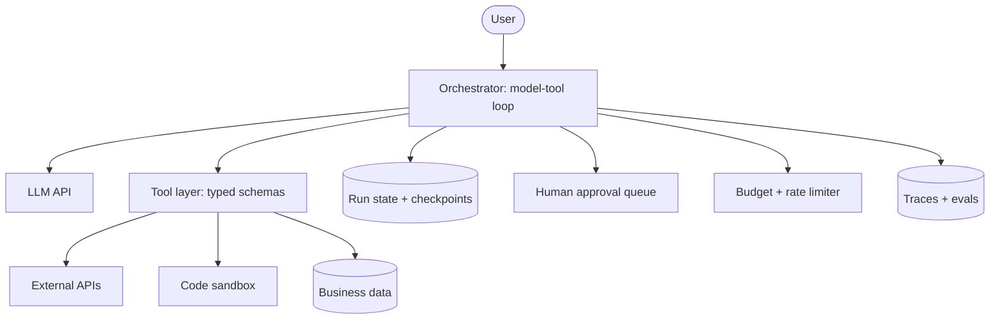

# Agent system with tools

A model runs in a loop: read state, pick a tool, observe the result, repeat until done.
The reliability of the tools and the guardrails around them matter more than the prompt.

## Diagram

## Trade-offs

- **Single agent vs multi-agent:** start with one agent and good tools; add sub-agents
  only when contexts clearly separate (research vs writing) and you can measure the gain.
- **Workflow vs agent:** if you can write the steps down, a deterministic workflow with an
  LLM per step is cheaper, faster and easier to test.
- **Structured tool errors:** cost a little design upfront but let the model self-repair.
- **Checkpointing:** adds storage but makes long runs resumable and debuggable.

## Failure modes and mitigations

1. **Runaway loops.** Hard limits on steps, tokens and wall-clock per run; detect repeated
   identical tool calls.
2. **Injection via tool output.** Treat tool results as data; require approval for
   destructive or external actions; least-privilege credentials per tool.
3. **Irreversible actions.** Dry-run modes, approval gates, and undo where possible.
4. **Non-reproducibility.** Log every model input and output and tool call; replay runs
   from traces in tests.
5. **Unreadable errors.** Tools return `{code, message, hint}`, never stack traces.

## Do not use it for

- Fixed, well-understood processes: write a workflow.
- Latency-critical paths (under a second): one model call, no loop.
- Actions where a mistake is catastrophic and cannot be reviewed by a human.
