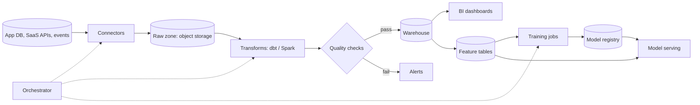

# Data / ML pipeline

Land raw data unchanged, transform it into tested models in a warehouse, and train and
serve ML models from the same feature definitions.

## Diagram

## Trade-offs

- **ELT in the warehouse vs ETL in Spark:** ELT with dbt is simpler and testable in SQL;
  Spark only when data or transforms outgrow the warehouse.
- **Managed connectors vs custom:** buy connectors for SaaS sources; write custom ones only
  for internal systems.
- **Feature store:** heavy for one or two models; feature tables in the warehouse plus a
  shared feature definition library are enough to start.
- **Batch vs online serving:** batch predictions written to a table are far simpler;
  online serving only when predictions depend on request-time data.

## Failure modes and mitigations

1. **Schema drift.** Contract tests on sources, and fail loudly on unexpected columns or
   types instead of coercing.
2. **Late or partial data.** Freshness and row-count checks per table; publish dashboards
   only after checks pass.
3. **Training/serving skew.** One feature definition used by both training and serving;
   log served features and compare distributions.
4. **Model drift.** Monitor prediction distributions and delayed ground-truth metrics;
   retrain on a schedule with a champion/challenger gate.
5. **Backfill cost.** Partition tables, backfill incrementally, and set warehouse budgets.

## Do not use it for

- Real-time decisions under 100 ms on fresh events: use a streaming design.
- A single small database with a few reports: query a read replica directly.
- One-off analysis: a notebook is fine; do not build a pipeline.
