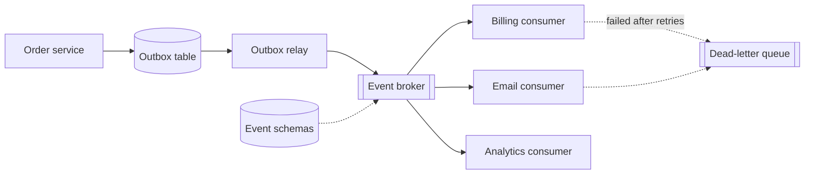

# Event-driven pipeline

Producers publish facts ("OrderPlaced") to a broker; consumers react independently. You
trade immediate consistency and easy debugging for decoupling and independent scaling.

## Diagram

## Trade-offs

- **Managed queue (SQS/SNS, Pub/Sub) vs Kafka:** managed queues need no ops and suit most
  teams; Kafka wins when you need replay, ordering per key and very high throughput, and
  you can staff it.
- **Outbox pattern:** one extra table and relay process, but it is the simplest way to make
  "write to DB and publish" atomic.
- **At-least-once delivery:** practical default; it forces idempotent consumers, which you
  need anyway.
- **Events vs commands:** publish facts that happened, not instructions to a specific
  service, or you have rebuilt RPC with extra latency.

## Failure modes and mitigations

1. **Duplicates.** Every consumer stores processed event ids or uses idempotency keys.
2. **Poison messages.** Bounded retries with backoff, then dead-letter with an alert and a
   replay tool.
3. **Schema breaks.** Version events, only add optional fields, and run contract tests in
   CI for every consumer.
4. **Lost events.** Use the outbox; never publish directly after a commit.
5. **Silent lag.** Alert on consumer lag and oldest-message age, not just errors.

## Do not use it for

- Request/response flows where the user waits for the result: use a synchronous API.
- A small team with two services: a job queue inside a monolith is simpler.
- Workflows needing strict, global ordering across all events.
