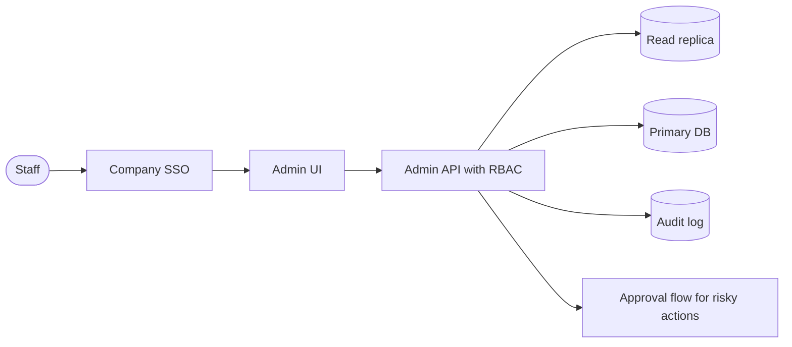

# Internal admin tool

A small app that lets staff search and fix production data. Its main risks are not scale
but damage: wrong changes, too much access, and no trail.

## Diagram

## Trade-offs

- **Low-code builder vs custom app:** low-code ships in days and suits CRUD; a custom app
  wins when workflows are complex or seat pricing gets expensive.
- **Go through the API vs direct DB writes:** routing writes through the same domain logic
  as the product prevents invalid states; direct SQL is faster to build and more dangerous.
- **Read replica:** small extra cost, removes the risk of admin searches slowing down
  customers.

## Failure modes and mitigations

1. **Destructive mistakes.** Soft deletes, confirmation for bulk actions, approvals for
   refunds or deletions, and point-in-time database recovery.
2. **Over-broad access.** RBAC from day one, least privilege, and mask sensitive fields by
   default.
3. **Production slowdown.** All reads and exports from the replica with query timeouts.
4. **Bypassed business rules.** Writes call the product's domain services, never raw SQL.

## Do not use it for

- Customer-facing features: build them in the product with proper UX and tenancy.
- Analytics and reporting at scale: use the data warehouse and BI tools.
- Automations that should run without a human: write a job or a workflow.
