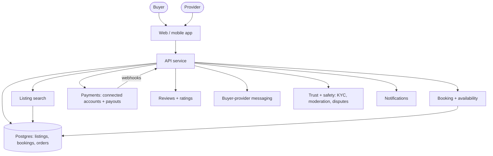

# Two-sided marketplace

Buyers find and pay providers; the platform holds the money, takes a cut and pays out. The
hard problems are trust, payments between strangers, and growing both sides at once, not
raw scale.

## Diagram

## Trade-offs

- **Payments provider with connected accounts (default):** handles KYC, split payments,
  payouts and tax forms. Building this yourself is a regulated money-transmission problem;
  buy it, and accept its fees and country coverage.
- **Postgres search first:** full-text plus filters (category, price, location) covers early
  catalogs; add a search engine only when relevance or faceting outgrows it.
- **Managed vs request-to-book:** instant booking converts better but needs reliable
  availability; request-to-book is simpler and gives providers control.
- **On-platform messaging:** costs effort and moderation, but keeps transactions on the
  platform and gives evidence for disputes.

## Failure modes and mitigations

1. **Double booking.** Reserve slots in a transaction with a unique constraint on
   (provider, time slot); hold a slot for a few minutes during checkout.
2. **Payout problems.** Use the payments provider's payout schedule, make webhook handlers
   idempotent, reconcile daily, and show providers a clear earnings ledger.
3. **Fraud and fake reviews.** Only allow reviews after a completed transaction, verify
   providers, rate-limit new accounts, and hold first payouts.
4. **Disintermediation.** Add value that only exists on-platform: payment protection,
   scheduling, reviews, insurance; detect contact details in early messages.
5. **KYC and tax blockers.** Check the payments provider's supported countries and payout
   requirements before choosing launch markets.

## Do not use it for

- A single seller selling to customers: that is a plain online shop.
- B2B procurement with negotiated contracts and invoicing: different workflow and tooling.
- Pure lead generation where the platform never touches the money: a directory is simpler.
