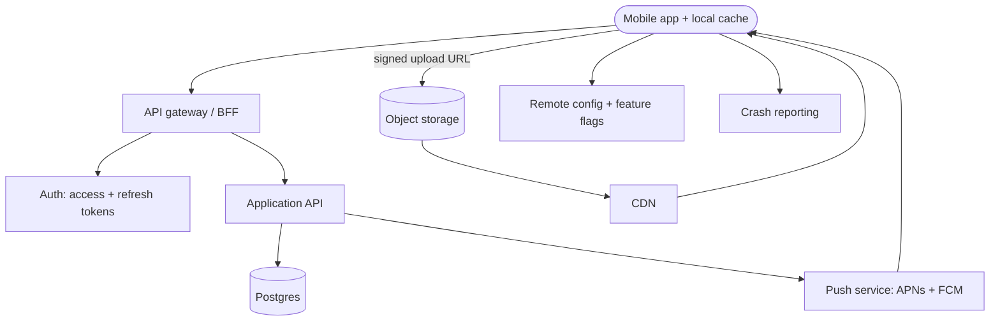

# Mobile app + API backend

A mobile client talks to a backend-for-frontend API. The hard constraints are old app
versions you cannot update and networks that drop requests halfway.

## Diagram

## Trade-offs

- **Backend-for-frontend:** an extra layer, but it shields the app from internal changes
  and lets you shape payloads for slow networks.
- **BaaS (Firebase, Supabase) vs custom API:** BaaS ships an MVP fastest; a custom API
  gives control over business logic and data. Many teams start BaaS and move hot paths.
- **Offline-first:** a local database plus sync is a large investment; do it only if users
  truly work offline. Otherwise cache reads and queue writes.
- **REST vs GraphQL:** GraphQL reduces round trips for complex screens but needs query cost
  limits; REST with versioned endpoints is simpler to cache and secure.

## Failure modes and mitigations

1. **Old versions break.** Version the API, only make additive changes, keep a minimum
   supported version check and a force-update screen.
2. **Duplicate writes.** Idempotency keys on every mutating request; exponential backoff
   with jitter on the client.
3. **Upload overload.** Clients upload directly to object storage with signed URLs.
4. **Stale push tokens.** Refresh tokens on app start, prune on provider errors, and track
   delivery rates.

## Do not use it for

- Content that works as a website: a responsive web app or PWA is much cheaper.
- Internal tools for a few employees: build a web admin tool.
- Real-time multiplayer or collaboration: see the realtime pattern.
