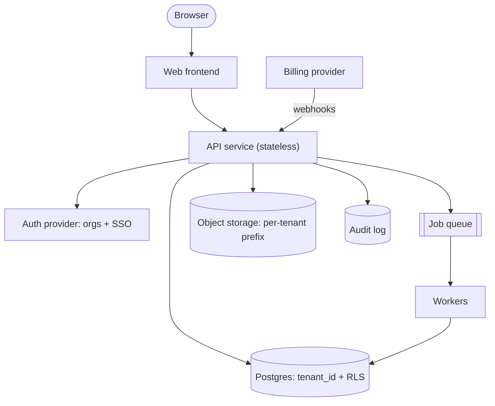

# Multi-tenant SaaS

One deployment serves every customer organization. Isolation is enforced in the data layer,
not by convention in application code.

## Diagram

## Trade-offs

- **Shared schema with tenant_id + row-level security (default):** cheapest to run and
  migrate. Isolation depends on RLS being on for every table, so test it.
- **Schema or database per tenant:** stronger isolation and easy per-tenant restore, but
  migrations fan out to N databases and connection counts explode. Reserve for enterprise
  tiers that pay for it.
- **Buy auth:** organizations, invites, SSO/SAML and SCIM are months of work; buy them.
- **Stateless API:** lets you scale horizontally; keep sessions in the auth provider or a
  shared store.

## Failure modes and mitigations

1. **Cross-tenant leak.** Enforce Postgres RLS using a session variable set per request;
   add an automated test that runs every endpoint as tenant A against tenant B's ids.
2. **Noisy neighbor.** Per-tenant rate limits, per-tenant job concurrency caps, and query
   timeouts.
3. **Billing drift.** Make webhook handlers idempotent (store event ids) and reconcile plan
   state nightly against the billing provider.
4. **Late data-residency demands.** Keep region in the tenant record from day one so a
   second regional deployment is configuration, not a rewrite.

## Do not use it for

- Single-customer internal tools: you pay the tenancy complexity for nothing.
- Consumer apps where every user is their own "tenant": plain per-user ownership is enough.
- Regulated customers that contractually require physical isolation: plan dedicated
  deployments instead.
