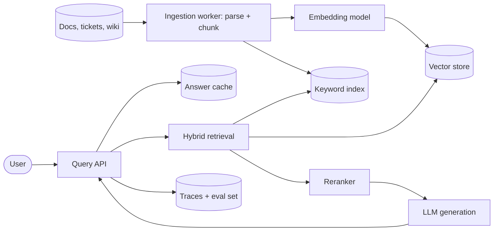

# RAG application

Retrieve the most relevant chunks of your own documents and let an LLM answer using only
those chunks, with citations. Retrieval quality, not the model, decides answer quality.

## Diagram

## Trade-offs

- **pgvector vs managed vector DB:** pgvector keeps one datastore and transactional access
  control up to a few million chunks. A managed vector DB scales further but adds a second
  source of truth that must be kept in sync with permissions.
- **Hybrid search (vector + keyword):** costs an extra index, but catches exact terms
  (error codes, product names) that embeddings blur. Default to hybrid.
- **Reranker:** adds 50 to 200 ms latency, usually the single biggest quality win after
  chunking. Skip only for very small corpora.
- **Chunk size:** small chunks retrieve precisely but lose context; start at 300 to 800
  tokens with overlap and measure.

## Failure modes and mitigations

1. **Silent retrieval misses.** Keep a labeled eval set of questions and expected sources;
   track recall@k on every chunking or model change. Let the model say "not found".
2. **Stale or deleted content.** Ingestion must be incremental and handle deletes; store a
   source version per chunk and re-index on change events.
3. **Prompt injection via documents.** Treat retrieved text as data, never instructions;
   strip or fence it, and never give the generation step tool access it does not need.
4. **Permission leaks.** Filter by the caller's ACL inside the retrieval query, not after
   generation.
5. **Token cost.** Cap retrieved context, cache frequent answers, route easy questions to a
   cheaper model.

## Do not use it for

- Tasks that need reasoning over the whole corpus at once (aggregate analytics): use SQL.
- Tiny, static knowledge that fits in a single prompt: just put it in the prompt.
- Changing the model's style or format: that is fine-tuning or prompting, not retrieval.
