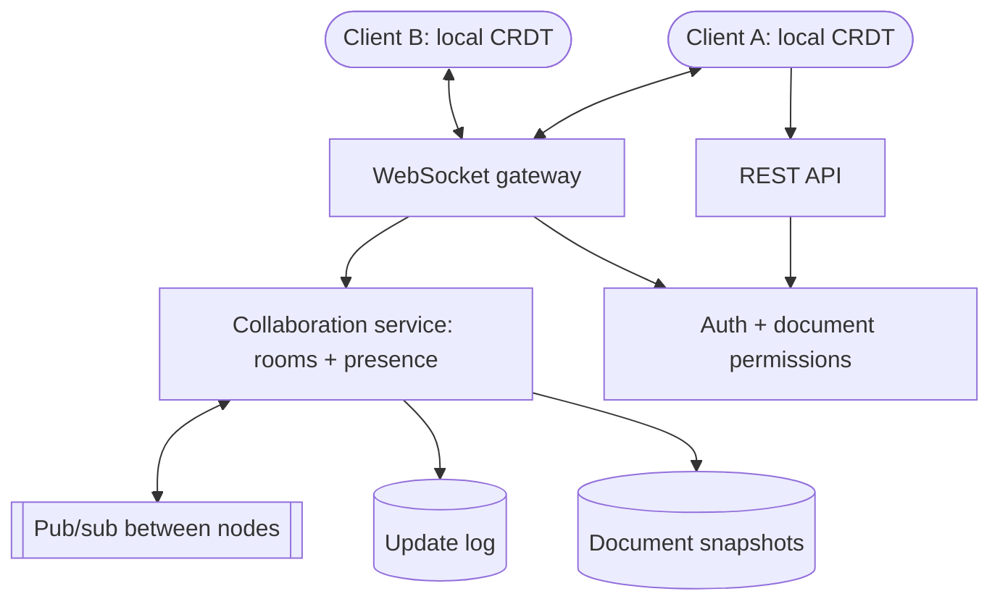

# Realtime collaboration app

Clients hold a local copy of the document and exchange small updates over WebSockets.
A CRDT or OT engine makes concurrent edits converge; the server persists snapshots.

## Diagram

## Trade-offs

- **CRDT library (Yjs, Automerge) vs OT:** a CRDT library handles offline edits and needs
  no central transform server; OT is proven for text but you will not write it correctly
  yourself. Use a library.
- **Managed realtime service vs own gateway:** managed services remove connection scaling
  work; your own gateway gives control and lower cost at scale.
- **Room affinity:** routing all users of a document to one node is simple and fast, but
  that node becomes a hotspot and single point of loss; persist updates before ack.

## Failure modes and mitigations

1. **Conflicting edits.** Use a CRDT/OT library; never last-write-wins whole documents.
2. **Node loss.** Append updates to a durable log before acknowledging; snapshot
   periodically and replay the log on recovery.
3. **Reconnect storms.** Client reconnect with jittered backoff; drain connections
   gradually during deploys.
4. **Slow initial sync.** Load the latest snapshot plus recent updates, compact history,
   and lazy-load large parts.
5. **Stale permissions.** Re-check permissions on each update batch and push revocations to
   connected clients.

## Do not use it for

- Data that changes every few minutes: polling or server-sent events are enough.
- Single-user editing with save: a normal REST API is simpler.
- Strictly ordered financial transactions: use a transactional database, not a CRDT.
